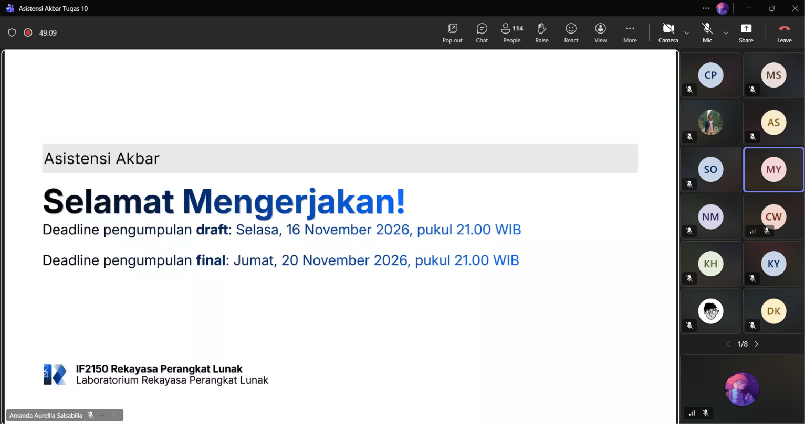

# Form Asistensi

## Tugas Besar IF2150 - Rekayasa Perangkat Lunak

| Informasi | Keterangan |
| --- | --- |
| **Hari** | *Sabtu* |
| **Tanggal** | *16/09/2026* |
| **Kelas** | *02* |
| **Nomor Kelompok** | *10*  |
| **Nama Kelompok** | *RPL at 25*  |
| **Nama Perangkat Lunak** | *SafeShe*  |
| **Dokumen** | *K02_G10_HIUPL*  |

### Anggota Kelompok

| NIM | Nama |
| --- | --- |
| *13525083* | *Natanael Chris Fabian Santoso* |
| *13525131* | *Mirza Aryasatya AkmalMirza Aryasatya Akmal* |
| *13525149* | *Ferdinand Valentino Darmawan* |
| *13525050* | *Jason Hartanto* |
| *13525065* | *Christopher Hendrik Gunawan* |

### Catatan

| Catatan |
| --- |
| 1. Bab 1 dan 2 sudah dikerjakan dari milestone-milestone sebelumnya jadi bisa dicopas dan disesuaikan dengan keadaan aktualnya, misalnya jika ada istilah penamaan baru dan penomoran. |
| 2. Bab 3 ini untuk mendokumentasikan hal-hal yang sudah diimplementasikan dan bisa lebih diperhatikan mengenai penamaan yang dipakai agar sesuai dengan DPPL yang sudah dibuat. |
| 3. Bab 4 ini untuk menunjukkan hasil pengujian yang sudah diverifikasi dari hal-hal yang sudah diimplementasi. Lalu untuk software testing, dapat dilakukan manual dan automatic testing. |
| 4. Bab 4.1 lebih fokus ke penentuan tingkat kedalaman kelas yang menentukan minimal pengujian dari sebuah kelas juga. |
| 5. Di bagian 4.2, itu akan ada revisi karena barisan 1 dan 2 yang di PPT itu agak redundan jadi ada kemungkinan ga bakal dipake. |
| 6. Untuk integration testing, itu pake database testing yang terdiri dari dummy data dan berbeda dengan database utama, cuma kalau hanya pake database utama, berarti dummy datanya nanti perlu direset lagi databasenya|
| 7. Lalu untuk meningkatkan coverage, boleh ditambahkan testingnya juga. |
| 8. Jika ada kelas yang diganti/dirombak, bikin testingnya berdasarkan yang terakhir kali dibikin. |
| 9. Lalu jika ada KNF yang targetnya terlalu optimal, bisa sampaikan di dokumen alasan kemungkinan hasil implementasi tidak sesuai dengan rancangan yang telah dibuat. |

**Notes for this section:**  
*Catatan dapat dituliskan dalam bentuk paragraf atau poin-poin, disesuaikan saja.* 

## Dokumentasi

<!--  -->

  

  <i>Gambar 1. Dokumentasi kegiatan asistensi.</i>

