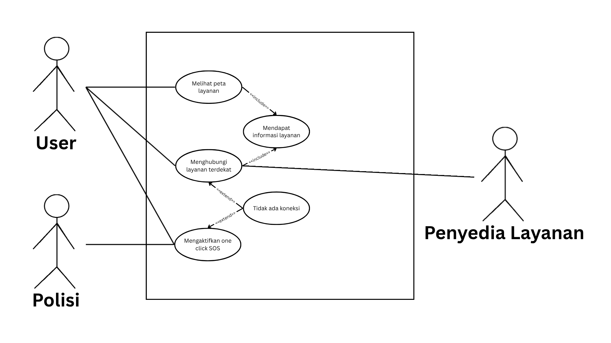

<h1>
IF2150 REKAYASA PERANGKAT LUNAK
 
TUGAS 10
 
HASIL IMPLEMENTASI DAN UJI PERANGKAT LUNAK (HIUPL)
</h1>
 

## *SafeShe*

### Untuk: *Aurelia Jennifer Gunawan*

Dipersiapkan oleh:
| Informasi | Keterangan |
| --- | --- |
| Kelas | *K2* |
| Kelompok | *10*  |

| NIM | Nama |
|---|---|
| *13525083* | *Natanael Chris Fabian Santoso* |
| *13525131* | *Mirza Aryasatya Akmal* |
| *13525149* | *Ferdinand Valentino Darmawan* |
| *13525050* | *Jason Hartanto* |
| *13525065* | *Christopher Hendrik Gunawan* |

---

## Daftar Isi

- [BAB 1: Pendahuluan](#bab-1-pendahuluan)
  - [1.1 Tujuan Penulisan Dokumen](#11-tujuan-penulisan-dokumen)
  - [1.2 Lingkup Masalah](#12-lingkup-masalah)
  - [1.3 Definisi, Istilah, dan Singkatan](#13-definisi-istilah-dan-singkatan)
  - [1.4 Aturan Penomoran](#14-aturan-penomoran)
  - [1.5 Referensi](#15-referensi)
  - [1.6 Deskripsi Umum Dokumen (Ikhtisar)](#16-deskripsi-umum-dokumen-ikhtisar)
- [BAB 2: Deskripsi Umum Perangkat Lunak](#bab-2-deskripsi-umum-perangkat-lunak)
- [BAB 3: Implementasi](#bab-3-implementasi)
  - [3.1 Lingkungan Implementasi](#31-lingkungan-implementasi)
  - [3.2 Implementasi Modul](#32-implementasi-modul)
  - [3.3 Implementasi Antarmuka](#33-implementasi-antarmuka)
  - [3.4 File Lain](#34-file-lain)
- [BAB 4: Hasil Pengujian](#bab-4-hasil-pengujian)
  - [4.1 Strategi dan Kedalaman Pengujian Kelas](#41-strategi-dan-kedalaman-pengujian-kelas)
  - [4.2 Pengujian Unit Kelas](#42-pengujian-unit-kelas)
  - [4.3 Pengujian Integrasi](#43-pengujian-integrasi)
  - [4.4 Pengujian Use Case](#44-pengujian-use-case)
  - [4.5 Pengujian Kebutuhan Non-Fungsional (KNF)](#45-pengujian-kebutuhan-non-fungsional-knf)
  - [4.6 Tangkapan Layar dan Bukti Hasil Pengujian](#46-tangkapan-layar-dan-bukti-hasil-pengujian)
- [BAB 5: Traceability](#bab-5-traceability)

---

## Daftar Perubahan

| Revisi | Deskripsi |
| :--- | :--- |
| *A* |  |
| *B* |  |
| *C* |  |

---

# BAB 1: Pendahuluan

## 1.1 Tujuan Penulisan Dokumen
Dokumen HIUPL ini merangkum lingkungan dan modul SafeShe yang diimplementasikan serta hasil pengujian yang tersedia. Dokumen ini menjadi acuan bagi tim pengembang dan asisten untuk meninjau keterlacakan kebutuhan dari SKPL, rancangan DPPL, implementasi, dan pengujian.

## 1.2 Lingkup Masalah
Aplikasi SafeShe adalah aplikasi yang menyediakan pelaporan kekerasan seksual yang dialami perempuan secara anonim. Aplikasi ini dibuat agar menjadi salah satu solusi untuk mengatasi proses pelaporan dan pendampingan korban dari kekerasan seksual di Indonesia yang masih reaktif dan tidak terintegrasi secara digital. SafeShe akan menyediakan fitur pelaporan anonim yang terenkripsi *end-to-end* dan memiliki peta *real-time* untuk menampilkan fasilitas layanan yang dapat dibutuhkan korban, seperti fasilitas rumah sakit dan konseling. SafeShe juga menyediakan fitur *one-click SOS* untuk memudahkan korban dalam meminta bantuan secara diam-diam dengan konfirmasi balik yang tidak mudah diketahui orang lain ketika bantuan sedang dalam perjalanan menuju lokasi korban. Selain itu, SafeShe akan merekam audio di sekitar korban setelah *one-click SOS* dipencet yang dapat membantu dalam memberikan bukti konkret untuk membantu pembuatan kasus terhadap pelaku kekerasan seksual.

## 1.3 Definisi, Istilah, dan Singkatan
Istilah dan singkatan yang digunakan dalam dokumen HIUPL SafeShe dijelaskan berikut.

Tabel 1.3. Definisi Istilah dan Singkatan

| Singkatan, Akronim, atau Istilah | Penjelasan |
| :--- | :--- |
| *P/L* | *Singkatan dari Perangkat Lunak, yaitu aplikasi yang memberikan perintah kepada komputer untuk menjalankan tugas tertentu.* |
| *SKPL* | *Singkatan dari Spesifikasi Kebutuhan Perangkat Lunak, yaitu dokumen yang merangkum kriteria-kriteria yang diperlukan untuk membangun aplikasi menjalankan tugasnya.* |
| *DPPL* | *Singkatan dari Deskripsi Perancangan Perangkat Lunak, yaitu dokumen yang menjelaskan rancangan arsitektur, kelas, dan antarmuka P/L.* |
| *HIUPL* | *Singkatan dari Hasil Implementasi dan Uji Perangkat Lunak, yaitu dokumen yang melaporkan hasil implementasi dan pengujian P/L.* |
| *KF* | *Singkatan dari Kebutuhan Fungsional.* |
| *KNF* | *Singkatan dari Kebutuhan Non-Fungsional.* |
| *UC* | *Singkatan dari Use Case.* |
| *TC* | *Singkatan dari Test Case, yaitu satu kasus uji untuk skenario tertentu.* |
| *UT* | *Singkatan dari Unit Test, yaitu test case tingkat kelas/operasi.* |
| *INT* | *Singkatan dari Integration Test, yaitu test case yang menguji interaksi antarkomponen.* |
| *Boundary* | *Kasus uji pada nilai batas masukan, misalnya nilai minimum, maksimum, atau tepat di ambang aturan.* |
| *Coverage* | *Persentase baris/cabang kode yang dieksekusi oleh pengujian.* |
| *SQLite* | *Sistem manajemen basis data relasional yang digunakan SafeShe.* |
| *Fernet* | *Skema enkripsi simetris dari pustaka `cryptography` untuk mengenkripsi payload laporan.* |
| *API* | *Application Programming Interface, antarmuka komunikasi antarkomponen perangkat lunak.* |

## 1.4 Aturan Penomoran
Dokumen ini memakai ID KF, KNF, UC, dan kelas sesuai SKPL/DPPL; ID test case mengikuti pola HIUPL yang tercantum pada tabel berikut.

Tabel 1.4. Aturan Penomoran

| Hal/Bagian | Penomoran | Keterangan |
| :--- | :--- | :--- |
| *Kebutuhan Fungsional* | *KFXX* | *Sesuai SKPL* |
| *Kebutuhan Non-Fungsional* | *KNFXX* | *Sesuai SKPL* |
| *Use Case* | *UCXX* | *Sesuai SKPL* |
| *Kelas* | *CXX* | *Sesuai DPPL* |
| *Antarmuka* | *I-XX* | *Sesuai DPPL* |
| *Test Case Unit* | *CXX-UTYY* | *XX adalah nomor kelas, YY adalah nomor urut test case unit pada kelas tersebut* |
| *Test Case Integrasi* | *INT-TCYY* | *YY adalah nomor urut test case integrasi* |
| *Test Case Use Case* | *UCXX-TCYY* | *XX adalah nomor use case, YY adalah nomor urut test case pada use case tersebut* |
| *Test Case KNF* | *KNFXX-TCYY* | *XX adalah nomor KNF, YY adalah nomor urut test case pada KNF tersebut* |

## 1.5 Referensi
1. [SKPL M5](../M5/K02_G10_SKPL.md)
2. [APL M6](../M6/K02_G10_APL.md)
3. [DPPL M8](../M8/K02_G10_DPPL2.md)
4. [Implementasi M9](../M9/K02_G10_Implementasi.md)
5. [README dan dependensi implementasi](../../src/README.md), termasuk FastAPI, Uvicorn, SQLite, cryptography/Fernet, pytest, dan httpx.

## 1.6 Deskripsi Umum Dokumen (Ikhtisar)
Bab 1 menjelaskan tujuan, lingkup, istilah, penomoran, dan referensi; Bab 2 memberi gambaran SafeShe dan konteks sistem; Bab 3 mencatat lingkungan serta modul dan antarmuka yang diimplementasikan; Bab 4 merangkum strategi dan hasil pengujian yang tersedia; Bab 5 menghubungkan kebutuhan fungsional dengan implementasi dan pengujian.

 

---

# BAB 2: Deskripsi Umum Perangkat Lunak

SafeShe melayani Korban melalui aplikasi web dan menyediakan dashboard bagi Polisi. Aplikasi mencakup SOS, peta dan kontak layanan, pelaporan, serta status penanganan. Integrasi nyata dengan sistem kepolisian dan API layanan belum tersedia; aplikasi menggunakan data layanan lokal/seed dan dashboard polisi demo.

<i>Gambar 2.1. Use Case Diagram SafeShe</i>

 

---

# BAB 3: Implementasi

Bagian ini diisi dengan informasi tentang elemen P/L yang dikembangkan (*executable files*, *configuration files*, *data files*, dan sebagainya) serta perubahannya terhadap rancangan pada DPPL (jika ada).

## 3.1 Lingkungan Implementasi

Implementasi menggunakan klien web HTML/JavaScript dan SQLite, serta server FastAPI modular yang dijalankan secara lokal, menggantikan rancangan React Native dan PostgreSQL. Rincian perangkat keras, sistem operasi, dan IDE tidak tersedia.

Tabel 3.1. Lingkungan Implementasi

| Aspek | Keterangan |
| :--- | :--- |
| *Hardware* |  |
| *Operating System* |  |
| *Bahasa Pemrograman* | *Python 3.12, HTML, JavaScript, CSS* |
| *Framework/Library* | *FastAPI 0.115.6, Uvicorn 0.34.0, python-multipart 0.0.20, cryptography 44.0.0; Leaflet 1.9.4 via CDN* |
| *DBMS* | *SQLite* |
| *Development Tools* | *Git/GitHub, vscode, nvim* |
| *Testing Tools* | *pytest 8.3.4, httpx 0.28.1, cProfile, SQLite `EXPLAIN QUERY PLAN`* |

## 3.2 Implementasi Modul

Daftar modul/kelas yang **TELAH** diimplementasikan. Gunakan nama dan ID kelas yang sama dengan DPPL, dan konsisten dengan Tabel B.5 pada dokumen Implementasi (Tugas 9).

Tabel 3.2. Implementasi Modul

| No | ID Kelas | Nama Modul/Kelas | Nama File Fisik | Nama File Executable |
| :--- | :--- | :--- | :--- | :--- |
| 1 | *C01* | *OneClickSOS* | *`src/backend/domain/sos.py`* | *-* |
| 2 | *C02* | *AntarmukaPolisi* | *`src/frontend/police.html`, `src/backend/main.py`* | *`police.html`* |
| 3 | *C03* | *Korban* | *`src/backend/domain/sos.py`* | *-* |
| 4 | *C04* | *Peta* | *`src/backend/domain/layanan.py`* | *-* |
| 5 | *C05* | *ListLayanan* | *`src/backend/domain/layanan.py`* | *-* |
| 6 | *C06* | *Layanan* | *`src/backend/domain/layanan.py`* | *-* |
| 7 | *C07* | *AntarmukaTelepon* | *`src/frontend/index.html`, `src/frontend/app.js`* | *-* |
| 8 | *C08* | *Polisi* | *`src/backend/domain/sos.py`* | *-* |
| 9 | *C09* | *Rekaman* | *`src/backend/domain/sos.py`* | *-* |
| 10 | *C10* | *LaporanKekerasan* | *`src/backend/domain/laporan.py`* | *-* |
| 11 | *C11* | *APILayanan* | *`src/backend/domain/layanan.py`* | *-* |
| 12 | *C12* | *AntarmukaPetaLayanan* | *`src/frontend/index.html`, `src/frontend/app.js`* | *-* |

## 3.3 Implementasi Antarmuka

Daftar antarmuka yang telah diimplementasikan. Gunakan ID dan nama layar yang sama dengan ID dan nama layar pada tugas DPPL.

Tabel 3.3. Implementasi Antarmuka

| No | ID Antarmuka | Nama Antarmuka | Nama File Fisik | Nama File Executable |
| :--- | :--- | :--- | :--- | :--- |
| 1 | *I-01* | *Layar Utama* | *`src/frontend/index.html`, `src/frontend/app.js`* | *`index.html`* |
| 2 | *I-02* | *Peta Layanan Terdekat* | *`src/frontend/index.html`, `src/frontend/app.js`* | *`index.html`* |
| 3 | *I-03* | *Detail Layanan* | *`src/frontend/index.html`, `src/frontend/app.js`* | *`index.html`* |
| 4 | *I-04* | *Status Bantuan Samar / Catatan* | *`src/frontend/index.html`, `src/frontend/app.js`* | *`index.html`* |
| 5 | *I-05* | *Pembuatan Laporan* | *`src/frontend/index.html`, `src/frontend/app.js`* | *`index.html`* |
| 6 | *I-06* | *Laporan Sedang Dikirim* | *`src/frontend/index.html`, `src/frontend/app.js`* | *`index.html`* |
| 7 | *I-07* | *Konfirmasi Laporan* | *`src/frontend/index.html`, `src/frontend/app.js`* | *`index.html`* |
| 8 | *I-08* | *Respons Petugas - SOS Terkirim* | *`src/frontend/index.html`, `src/frontend/app.js`* | *`index.html`* |
| 9 | *I-09* | *Respons Petugas - Bantuan Menuju Lokasi* | *`src/frontend/index.html`, `src/frontend/app.js`* | *`index.html`* |
| 10 | *I-010* | *Respons Petugas - SOS Menunggu Koneksi* | *`src/frontend/index.html`, `src/frontend/app.js`* | *`index.html`* |
| 11 | *I-011* | *Pusat Respons Polisi* | *`src/frontend/police.html`* | *`police.html`* |

## 3.4 File Lain

Daftar file lain yang dibuat selain file kelas dan antarmuka, misalnya file *utility*, *configuration*, *database schema/seed*, *file test*, atau *data*.

Tabel 3.4. File Lain

| No | Nama File | Keterangan |
| :--- | :--- | :--- |
| 1 | *`src/backend/main.py`* | *Route API dan penyajian halaman web.* |
| 2 | *`src/backend/db.py`, `seed.py`* | *Koneksi, skema, migrasi, dan data awal SQLite.* |
| 3 | *`src/backend/config.py`, `crypto.py`* | *Konfigurasi dan enkripsi payload laporan.* |
| 4 | *`src/frontend/style.css`, `icons.svg`* | *Gaya antarmuka dan ikon.* |
| 5 | *`src/tests/test_api.py`* | *Pengujian otomatis API dan logika domain.* |
| 6 | *`src/tests/profile_nearby.py`* | *Profiling pencarian layanan terdekat.* |

 

---

# BAB 4: Hasil Pengujian

Bab ini merangkum hasil pengujian yang tersedia. Enam belas tes otomatis lolos dan mencakup beberapa kelompok fungsi; hasil individual per test case HIUPL tidak tersedia, sehingga tabel berikut menyajikan hasil secara agregat.

## 4.1 Strategi dan Kedalaman Pengujian Kelas

Pengujian otomatis mencakup API dan logika domain. Tabel berikut mengklasifikasikan tingkat pengujian kelas berdasarkan fungsinya pada DPPL dan implementasi.

Tabel 4.1.1. Identifikasi Tingkat Pengujian Kelas

| ID Kelas | Nama Kelas | Tingkat | Alasan | Test Case Terkait |
| :--- | :--- | :--- | :--- | :--- |
| *C01* | *OneClickSOS* | *Mendalam* | *Mengelola alur SOS, idempotensi, status, dan balasan* |  |
| *C02* | *AntarmukaPolisi* | *Sedang* | *Antarmuka dashboard dan route polisi* |  |
| *C03* | *Korban* | *Sedang* | *Menghubungkan data korban dengan layanan dan SOS* |  |
| *C04* | *Peta* | *Sedang* | *Menyediakan pencarian lokasi sekitar* |  |
| *C05* | *ListLayanan* | *Mendalam* | *Mengurutkan dan menyaring layanan berdasarkan jarak/radius* |  |
| *C06* | *Layanan* | *Sedang* | *Menyediakan data, alamat, fasilitas, dan kontak layanan* |  |
| *C07* | *AntarmukaTelepon* | *Tidak perlu* | *Tautan telepon pada antarmuka; tidak ada logika domain kelas tersendiri* | *-* |
| *C08* | *Polisi* | *Sedang* | *Mengelola respons polisi dan unit terdekat* |  |
| *C09* | *Rekaman* | *Sedang* | *Mengelola unggahan dan penyimpanan segmen audio* |  |
| *C10* | *LaporanKekerasan* | *Mendalam* | *Memvalidasi, mengenkripsi, menyimpan, dan mengatur status laporan* |  |
| *C11* | *APILayanan* | *Sedang* | *Mengambil dan menyaring data layanan* |  |
| *C12* | *AntarmukaPetaLayanan* | *Sedang* | *Menyajikan peta dan penanda layanan pada klien* |  |

## 4.2 Pengujian Unit Kelas

Terdapat 16 tes otomatis yang dijalankan melalui pytest pada `src/tests/test_api.py`, mencakup haversine, urutan/radius dan filter layanan, kontak kosong, alur SOS (idempotensi, autentikasi polisi, rekaman dan balasan), SOS tanpa lokasi, validasi laporan, enkripsi dan mode anonim, status SOS, unit polisi terdekat, detail layanan, tindak lanjut laporan, status publik pelapor, serta migrasi database lama. Seluruh 16 tes lolos.

Perintah test: `cd src && python -m pytest tests -v`. Lokasi: `src/tests/test_api.py`.

## 4.3 Pengujian Integrasi

Terdapat tes API yang memeriksa alur lintas route, logika domain, dan SQLite, termasuk simpan/ambil status, enkripsi laporan, migrasi, serta dashboard polisi. 16 tes otomatis lolos secara keseluruhan.

Tabel 4.3.1. Daftar Antarmuka Antarkomponen

| ID Antarmuka | Komponen Asal | Komponen Tujuan | Jenis Batas | Test Case |
| :--- | :--- | :--- | :--- | :--- |
| *Tambahan HIUPL* | *FastAPI routes* | *Domain SOS, layanan, laporan* | *Route - domain* | *Tercakup dalam suite API* |
| *Tambahan HIUPL* | *Backend* | *SQLite* | *Aplikasi - basis data* | *Tercakup dalam suite API* |
| *Tambahan HIUPL* | *Aplikasi* | *Sistem kepolisian eksternal* | *Aplikasi - sistem eksternal* |  |

## 4.4 Pengujian Use Case

Terdapat tujuh use case. Tes otomatis mencakup beberapa alur SOS, layanan, laporan, dan respons polisi; hasil per skenario use case tidak tersedia.

| ID Use Case | Nama Use Case (SKPL) | Bukti pengujian |
| :--- | :--- | :--- |
| *UC01* | *Mengaktifkan one click SOS* |  |
| *UC02* | *Melihat Peta Layanan Terdekat* |  |
| *UC03* | *Memilih Layanan Terdekat* |  |
| *UC04* | *Menghubungi Layanan Terdekat* |  |
| *UC05* | *Membuat Laporan Kekerasan* |  |
| *UC06* | *Merekam Suara Otomatis Ketika One Click SOS Diaktifkan* |  |
| *UC07* | *Mengirim Notifikasi Konfirmasi Polisi Ke Korban* |  |

## 4.5 Pengujian Kebutuhan Non-Fungsional (KNF)

Pengujian terukur untuk KNF belum dilakukan. Profiling layanan nearby merupakan optimasi performa, bukan pengukuran terhadap target waktu respons KNF. Hasil pengukuran formal KNF masih perlu diverifikasi.

| ID Pengujian | ID KNF | Parameter | Target Terukur | Metode dan Alat | Hasil Aktual | Kesimpulan |
| :--- | :--- | :--- | :--- | :--- | :--- | :--- |
|  | *KNF01* | *Availability* | *SOS dapat digunakan kapan saja* |  |  | *Belum diuji* |
|  | *KNF02* | *Safety* | *Pelaporan tidak diketahui pelaku* |  | *Batasan penyamaran dan data peramban* | *Belum diuji* |
|  | *KNF03* | *Reliability* | *Sistem melibatkan polisi* | *Dashboard polisi disimulasikan* |  | *Tidak terpenuhi sebagai integrasi nyata* |
|  | *KNF04* | *Security* | *Laporan diamankan* | *Tes enkripsi* | *Enkripsi sisi server, bukan E2E* | *Teruji sebagian; berbeda dari rancangan* |
|  | *KNF05* | *Security* | *Keabsahan bukti terjamin* |  |  | *Belum terpenuhi* |
|  | *KNF06* | *Information* | *Informasi layanan terbaru dan relevan* | *Data layanan lokal/seed* |  | *Belum diuji* |
|  | *KNF07* | *Availability* | *Pengalihan ke aplikasi telepon bila layanan tersedia* | *Tautan `tel:` diimplementasikan* |  | *Belum diuji* |
|  | *KNF08* | *Security* | *Bukti diambil/disimpan sesuai regulasi* |  |  | *Belum diuji* |
|  | *KNF09* | *Responsivity* | *Polisi dapat mengirim konfirmasi* | *Balasan dashboard dan polling diimplementasikan* |  | *Terimplementasi; belum diukur* |

## 4.6 Tangkapan Layar dan Bukti Hasil Pengujian

Enam belas tes otomatis lolos dan profiling layanan nearby telah dilakukan. Keluaran pytest, laporan coverage, tangkapan layar pengujian use case, dan bukti pengukuran KNF belum tersedia.

| ID Pengujian | Bukti Hasil Pengujian |
| :--- | :--- |
| *Suite API, 16 tes lolos* | *`src/tests/test_api.py`* |
| *Profiling layanan nearby* | *`src/tests/profile_nearby.py`; rerata 89,06 ms menjadi 3,17 ms pada dataset 50.000 layanan tes* |
| *Coverage per kelas* |  |
| *Tangkapan layar pengujian use case* |  |
| *Bukti pengukuran KNF* |  |

 

---

# BAB 5: Traceability

Petakan setiap KF ke KNF, use case, kelas perancangan, file implementasi, dan test case. Tabel traceability berikut akan menjadi sarana verifikasi KF. Setiap KF memiliki minimal satu test case dan dinyatakan terpenuhi apabila **seluruh** test case terkaitnya berkesimpulan `Pass`. KF yang tidak diimplementasikan tetap dicantumkan beserta alasannya.

Tabel 5.1. Matriks Kerunutan KF terhadap Implementasi dan Pengujian

| KF ID | KNF Terkait | Use Case ID | Kelas Terkait | Implementasi File Terkait | Test Case (UC) | Test Case (Unit/Integrasi/KNF) |
| :--- | :--- | :--- | :--- | :--- | :--- | :--- |
| *KF01* | *KNF01* | *UC01* | *C01 OneClickSOS, C03 Korban* | *`src/backend/domain/sos.py`, `src/frontend/app.js`* |  | *Suite API (agregat)* |
| *KF02* | *KNF02* | *UC01, UC05* | *C01 OneClickSOS, C10 LaporanKekerasan* | *`src/backend/domain/sos.py`, `src/backend/domain/laporan.py`* |  | *Suite API (agregat)* |
| *KF03* | *KNF04, KNF05* | *UC01, UC05* | *C01 OneClickSOS, C10 LaporanKekerasan* | *`src/backend/domain/laporan.py`, `src/backend/crypto.py`* |  | *Tes enkripsi disebut pada suite API; blockchain tidak diimplementasikan* |
| *KF04* | *KNF01* | *UC01* | *C01 OneClickSOS* | *`src/frontend/app.js`* |  |  |
| *KF05* | *KNF06* | *UC02, UC03* | *C04 Peta, C05 ListLayanan, C06 Layanan, C12 AntarmukaPetaLayanan* | *`src/backend/domain/layanan.py`, `src/frontend/app.js`* |  | *Suite API mencakup pencarian layanan (agregat)* |
| *KF06* | *KNF06* | *UC02, UC03* | *C05 ListLayanan, C11 APILayanan* | *`src/backend/domain/layanan.py`* |  | *Data layanan lokal/seed* |
| *KF07* | *KNF02* | *UC01, UC06* | *C01 OneClickSOS, C09 Rekaman* | *`src/frontend/app.js`, `src/backend/domain/sos.py`* |  | *Endpoint rekaman diuji* |
| *KF08* | *KNF09* | *UC01, UC07* | *C01 OneClickSOS, C02 AntarmukaPolisi, C08 Polisi* | *`src/backend/domain/sos.py`, `src/frontend/police.html`, `src/frontend/app.js`* |  | *Tes balasan/status disebut dalam suite API* |
| *KF09* | *KNF03* | *UC01* | *C01 OneClickSOS, C03 Korban* | *`src/backend/domain/sos.py`, `src/frontend/app.js`* |  |  |
| *KF10* | *KNF03* | *UC01* | *C01 OneClickSOS, C08 Polisi* | *`src/backend/domain/sos.py`, `src/frontend/police.html`* |  | *Perubahan status diuji melalui simulasi; tidak ada integrasi nyata* |
| *KF11* | *KNF05, KNF08* | *UC06* | *C09 Rekaman, C08 Polisi* | *`src/backend/domain/sos.py`, `src/frontend/police.html`* |  | *Tes unggah rekaman tercakup agregat; kepatuhan bukti tidak diuji* |
| *KF12* | *KNF06, KNF07* | *UC04* | *C03 Korban, C06 Layanan, C07 AntarmukaTelepon* | *`src/backend/domain/layanan.py`, `src/frontend/index.html`, `src/frontend/app.js`* |  |  |

Tabel 5.2. Matriks Kerunutan KNF terhadap Pengujian

| ID KNF | Parameter | KF/UC Terkait | Test Case |
| :--- | :--- | :--- | :--- |
| *KNF01* | *Availability* | *KF01, KF04 / UC01* |  |
| *KNF02* | *Safety* | *KF02, KF07 / UC01, UC05, UC06* |  |
| *KNF03* | *Reliability* | *KF09, KF10 / UC01* |  |
| *KNF04* | *Security* | *KF03 / UC01, UC05* | *Tes enkripsi agregat pada suite API* |
| *KNF05* | *Security* | *KF03, KF11 / UC01, UC05, UC06* |  |
| *KNF06* | *Information* | *KF05, KF06, KF12 / UC02, UC03, UC04* | *Tes layanan agregat* |
| *KNF07* | *Availability* | *KF12 / UC04* |  |
| *KNF08* | *Security* | *KF11 / UC06* |  |
| *KNF09* | *Responsivity* | *KF08 / UC01, UC07* | *Tes balasan agregat* |
