<h1>
IF2150 REKAYASA PERANGKAT LUNAK
<br>
TUGAS 7
<br>
DESKRIPSI PERANCANGAN PERANGKAT LUNAK (DPPL)
</h1>
<br>

## *SafeShe*

### Untuk: *Aurelia Jennifer Gunawan*

Dipersiapkan oleh:
| Informasi | Keterangan |
| --- | --- |
| Kelas | *K2* |
| Kelompok | *10*  |

| NIM | Nama |
|---|---|
| *13525083* | *Natanael Chris Fabian Santoso* |
| *13525131* | *Mirza Aryasatya Akmal* |
| *13525149* | *Ferdinand Valentino Darmawan* |
| *13525050* | *Jason Hartanto* |
| *13525065* | *Christopher Hendrik Gunawan* |
---

## Daftar Perubahan

| Revisi | Deskripsi |
| :--- | :--- |
| *A* | *Deskripsikan perubahan yang dilakukan dari dokumen sebelumnya pada dokumen ini. Jika tidak terdapat perubahan, harap kosongkan tabel.* |
| *B* |  |
| *C* |  |
| ... |  |

---

# BAB 1: Pendahuluan

## 1.1 Tujuan Penulisan Dokumen

Dokumen DPPL ini dibuat untuk medeskripsikan dengan detail mengenai berbagai aspek dari perangkat lunak SafeShe agar semuanya memiliki spesifikasi yang jelas sebelum dikembangkan. Dokumen ini diperuntukkan untuk para pengembang perangkat lunak SafeShe dan asisten sebagai salah satu pemangku kepentingan dari pengimplementasian perangkat lunak yang dilakukan oleh para pengembang.


## 1.2 Lingkup Masalah

Aplikasi SafeShe adalah aplikasi yang menyediakan pelaporan kekerasan seksual yang dialami perempuan secara anonim. Aplikasi ini dibuat agar menjadi salah satu solusi untuk mengatasi proses pelaporan dan pendampingan korban dari kekerasan seksual di Indonesia yang masih reaktif dan tidak terintegrasi secara digital. SafeShe akan menyediakan fitur pelaporan anonim yang terenkripsi *end-to-end* dan memiliki peta *real-time* untuk menampilkan fasilitas layanan yang dapat dibutuhkan korban, seperti fasilitas rumah sakit dan konseling. SafeShe juga menyediakan fitur *one-click SOS* untuk memudahkan korban dalam meminta bantuan secara diam-diam dengan konfirmasi balik yang tidak mudah diketahui orang lain ketika bantuan sedang dalam perjalanan menuju lokasi korban. Selain itu, SafeShe akan merekam audio di sekitar korban setelah *one-click SOS* dipencet yang dapat membantu dalam memberikan bukti konkret untuk membantu pembuatan kasus terhadap pelaku kekerasan seksual.

## 1.3 Definisi, Istilah, dan Singkatan

| Singkatan, Akronim, atau Istilah | Penjelasan |
| :--- | :--- |
| *P/L* | *Singkatan dari Perangkat Lunak, yaitu aplikasi yang memberikan perintah kepada komputer untuk menjalankan tugas tertentu.* |
| *SKPL* | *Singkatan dari Spesifikasi Kebutuhan Perangkat Lunak, yaitu dokumen yang merangkum kriteria-kriteria yang diperlukan untuk membangun aplikasi menjalankan tugasnya.* |
| *KF* | *Singkatan dari Kebutuhan Fungsional.* |
| *KNF* | *Singkatan dari Kebutuhan Non-Fungsional.* |
| *UC* | *Singkatan dari Use Case.* |
| *EARS* | *Easy Approach to Requirements Syntax, yaitu pola penulisan kebutuhan agar konsisten dan mudah diuji.* |

## 1.4 Aturan Penomoran

| Hal/Bagian | Penomoran | Keterangan |
| :--- | :--- | :--- |
| *Kebutuhan Fungsional* | *KFXX* | *"KF" dilanjutkan dengan nomor id* |
| *Kebutuhan Non-Fungsional* | *KNFXX* | *"KNF" dilanjutkan dengan nomor id* |
| *Aktor* | *AXX* | *"A" dilanjutkan dengan nomor id* |
| *Use Case* | *UCXX* | *"UC" dilanjutkan dengan nomor id* |
| *Kelas* | *CXX* | *"C" dilanjutkan nomor id* |
| *User* | *US-XX* | *"US-" dilanjutkan dengan nomor id* |
| *Requirement* | *RXX* | *"R" dilanjutkan dengan nomor id* |

## 1.5 Referensi

Mayoritas dari BAB 1 berasal dari dokumen SKPL, BAB 2 berasal dari dokumen APL, BAB 3 menggunakan dokumen SKPL sebagai rancangan awal dari apa saja yang perlu dibuat di dalamnya, serta BAB 4 dan 5 berasal dari dokumen SKPL.

## 1.6 Deskripsi Umum Dokumen (Ikhtisar)
BAB 1 membahas pendahuluan dokumen berupa informasi umum dari dokumen, BAB 2 membahas perancangan arsitektur yang digunakan untuk pengembangan SafeShe, BAB 3 membahas rincian dari setiap use case yang disertai dengan diagram kelas dan sequence diagramnya, BAB 4 membahas diagram kelas dari keseluruhan use case, dan BAB 5 membahas Kerunutan dari setiap kelas yang ada dengan use case yang berkaitan.

<br>

---

# BAB 2: Perancangan Arsitektur

## 2.1 Rancangan Lingkungan Implementasi

| Komponen | Spesifikasi |
| :--- | :--- |
| *Server* | *Lingkungan Linux (Docker) yang dihosting pada layanan cloud (AWS/Google Cloud/Azure). Bahasa Python (FastAPI) dengan API Gateway* |
| *Client* | *React Native, penyimpanan lokal dengan SQLite, react-native-fs library* |
| *DBMS* | *PostgreSQL* |
| *OS* | *Cross-platform Android dan iOS* |

## 2.2 Style/Pattern Arsitektur Acuan

*Architectural Style* yang dipilih berdasarkan karakteristik P/L kami adalah **Decoupled Client-Server**, dengan model **Offline-First** pada *client* dan **Layered Modular** pada server.

Dari sisi *client*, P/L harus dapat mengirimkan laporan secara langsung untuk diproses walaupun pengguna dalam area tanpa akses ke internet. Ketika pengguna melaporkan kasus, React Native akan menyimpan *payload* yang terenkripsi ke SQLite. SQLite lalu secara cepat mengirimkan *payload* tersebut ke server ketika OS dari perangkat pengguna mendapatkan koneksi internet apapun. Setelah server menerima, *client* menghapus data SQLite demi keamanan.

Style yang dipilih dalam sisi server mengutamakan keistimewaan FastAPI dalam desain modular. Hal ini memungkinkan server terdiri dari beberapa lapisan *microservices*. Secara keseluruhan, P/L harus memprioritaskan dapat mengirimkan dan menerima laporan dalam situasi apapun, dan *style* dipilih berdasarkan kebutuhan tersebut.

Style yang dipilih memikirkan juga bawaan style dari teknologi yang dipakai. Contohnya, FastAPI secara bawaan mendukung *asynchronous programming*. Hal tersebut memungkinkan server secara cepat menerima dan memproses laporan yang baru saja dibuat oleh pengguna dan mengirimkan status ```202 Accepted``` ke *client* tanpa terganggu proses di latar belakang (*background processes*).

<p align="center">
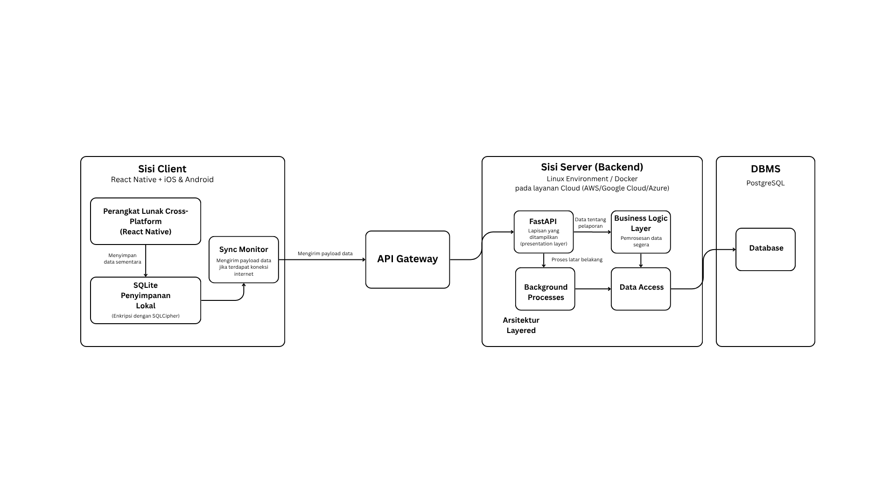
</p>
<p align="center">
<i>Gambar 1. Arsitektur yang dipilih (Decoupled Client-Server)</i>
</p>

## 2.3 Identifikasi Komponen / Modul / Subsistem

Tabel 2.3. Identifikasi Komponen/Modul/Subsistem

| Nama Komponen/Modul/Subsistem | Jenis                 | Penjelasan                                                                                                           |
| :---------------------------- | :-------------------- | :------------------------------------------------------------------------------------------------------------------- |
| *AntarmukaSOS* | *View* | *Menampilkan interface SOS SafeShe* |
| *AntarmukaPetaLayanan* | *View* | *Menampilkan peta dengan lokasi layanan* |
| *AntarmukaLaporan* | *View* | *Menampilkan detail formulir laporan kekerasan dan meneruskannya ke LaporanController* |
| *SOSController* | *Controller* | *Mengendalikan proses pengiriman signal SOS* |
| *PetaLayananController* | *Controller* | *Mengendalikan backend peta* |
| *LaporanController* | *Controller* | *Mengendalikan proses pembuatan laporan kekerasan dimulai dari menerima input dari AntarmukaLaporan, memeriksanya melalui ValidasiLaporan, lalu meneruskan laporan ke Polisi* |
| *OneClickSOS* | *Model* | *Fitur utama dari SafeShe* |
| *Korban* | *Model* | *Representasi data korban, seperti nama dan lokasi* |
| *Polisi* | *Model* | *Representasi data pihak polisi yang merespons SOS, seperti lokasi dan ketersediaan* |
| *Rekaman* | *Model* | *Data audio yang terekam* |
| *Peta* | *Model* | *Representasi data peta di sekitar korban* |
| *ListLayanan* | *Model* | *Representasi layanan-layanan terdekat yang diperoleh dari API layanan* |
| *Layanan* | *Model* | *Representasi layanan yang ada di database* |
| *LaporanKekerasan* | *Model* | *Representasi detail laporan kekerasan* |
| *ValidasiLaporan* | *Pendukung* | *Memvalidasi input formulir laporan sebelum diproses oleh LaporanController* |
| *PenyimpananLokal* | *Penyimpanan Data* | *Menyimpan rekaman secara lokal di device* |
| *SafeSheAPI* | *Komponen Backend* | *Backend FastAPI yang menghubungkan aplikasi dengan database dan sistem polisi* |
| *AntarmukaTelepon* | *Integrasi Perangkat* | *Representasi dari perangkat lunak telepon yang ada di device* |
| *SistemPolisi* | *Sistem Eksternal* | *Sistem sisi kepolisian yang menerima SOS, lokasi, dan rekaman, serta mengirim konfirmasi ke korban* |

## 2.4 Model Arsitektur Perangkat Lunak

## 2.4.1 Logical View

Logical View sebagai model arsitektur perangkat lunak yang lebih berfokus pada kebutuhan fungsional dari sistem mampu mendeskripsikan layanan atau fungsionalitas-fungsionalitas yang diberikan sistem kepada user. Model Logical View mampu menjabarkan kebutuhan sistem kepada user yang berbentuk komponen-komponen teknis (class, object, API, module). Logical View juga dapat direpresentasikan menggunakan Class Diagram, Sequence Diagram, atau Diagram Komunikasi.

Alasan Logical View dipilih untuk rancangan perangkat lunak SafeShe diantaranya:
1. Logical View mampu memapping fungsionalitas dari sistem menjadi modul-modul yang terpisah secara jelas dan saling berkaitan.
2. Logical View berfokus kepada use case dan bergantung pada aksi dari aktor utamanya (korban dan polisi).
3. Logical View mampu mendukung analisis keamanan dan privasi data dengan struktur internal yang tidak terikat infrastruktur fisik.
4. Logical View selaras dengan rancangan spek dan desain SafeShe yang sebagian besar sudah menggunakan Class Diagram.  

<p align="center">

</p>
<p align="center">
<i>Gambar 2. Logical View pada SafeShe</i>
</p>

<br>

---

# BAB 3: Realisasi Use Case

## 3.1 Use Case Mengaktifkan One-Click SOS

**ID Use Case:** *UC01*  
**Nama Use Case:** *Mengaktifkan one click SOS*

### 3.1.1 Identifikasi Kelas

Tabel 3.1. Identifikasi Kelas Use Case UC01

| No | Nama Kelas Perancangan | Nama Kelas Analisis Terkait |
|:--- | :--- | :--- |
| 1 | *OneClickSOS* | *OneClickSOS* |
| 2 | *AntarmukaPolisi* | *AntarmukaPolisi* |
| 3 | *Korban* | *Korban* | 
| 4 | *Polisi* | *Polisi* |

### 3.1.2 Sequence Diagram

- **Skenario Normal**

<p align="center">
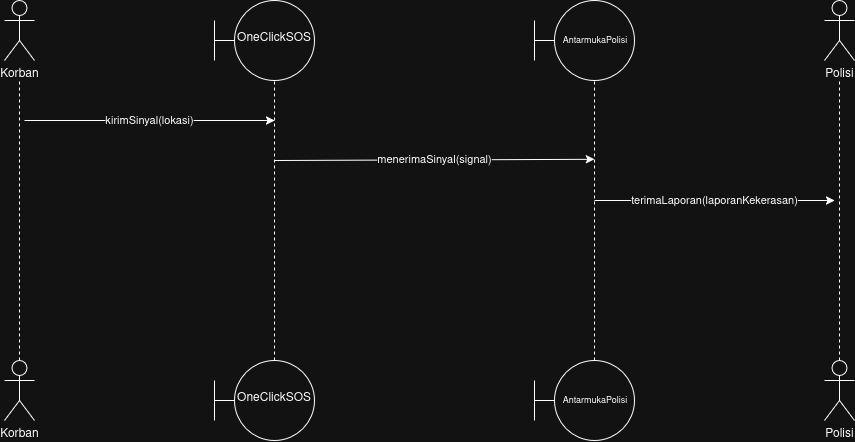
</p>
<p align="center">
<i>Gambar 3. Sequence Diagram UC01</i>
</p>

- **Skenario Alternatif 1: One Click SOS Tidak Dapat Ditampilkan Sebagai Widget Aplikasi**

<p align="center">
<i>Gambar 4. Sequence Diagram UC01 - One Click SOS Tidak Dapat Ditampilkan Sebagai Widget Aplikasi</i>
<i>Tidak ada diagram karena sistem tidak dapat diinteraksikan</i>
</p>

- **Skenario Alternatif 2: One Click SOS Tidak Berhasil Mengirimkan Informasi Keadaan Ke Pihak Berwajib**

<p align="center">
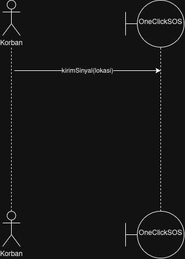
</p>
<p align="center">
<i>Gambar 5. Sequence Diagram UC01 - One Click SOS Tidak Berhasil Mengirimkan Informasi Keadaan Ke Pihak Berwajib</i>
</p>

### 3.1.3 Diagram Kelas

<p align="center">

</p>
<p align="center">
<i>Gambar 6. Diagram Kelas Mengaktifkan one click SOS</i>
</p>

## 3.2 Use Case 

**ID Use Case:** *UC02*  
**Nama Use Case:** *Melihat Peta Layanan Terdekat*

### 3.2.1 Identifikasi Kelas

Identifikasi kelas yang terkait dengan use case tersebut. Kelas di tahap perancangan dapat berbeda dengan dengan kelas di tahap analisis. Dapat menggunakan tabel di bawah:

Tabel 3.2. Identifikasi Kelas Use Case UC02

| No | Nama Kelas Perancangan | Nama Kelas Analisis Terkait |
|:--- | :--- | :--- |
| 1 | *Korban* | *Korban* |
| 2 | *AntarmukaPetaLayanan* | *AntarmukaPetaLayanan* |
| 3 | *Peta* | *Peta* |
| 4 | *ListLayanan* | *ListLayanan* | 
| 5 | *Layanan* | *Layanan* |
| 6 | *APILayanan* | *APILayanan* |

### 3.2.2 Sequence Diagram

Buat *sequence diagram* untuk **setiap skenario use case**, mencakup skenario normal dan alternatif pada subbab 4.4 SKPL. Diagram melibatkan kelas-kelas yang telah diidentifikasi pada SKPL. 

- **Skenario Normal**

<p align="center">
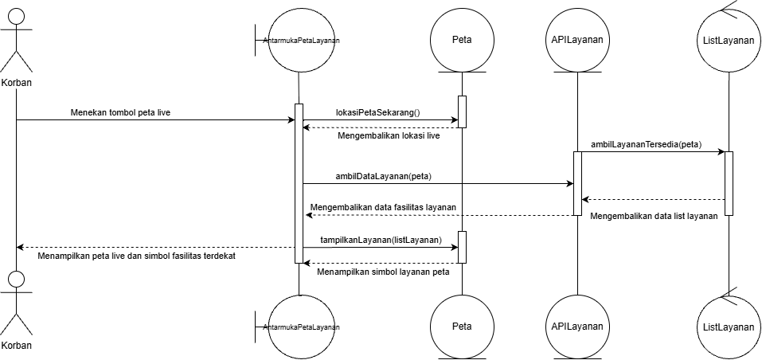
</p>
<p align="center">
<i>Gambar 7. Sequence Diagram UC02</i>
</p>

- **Skenario Alternatif 1: API Tidak Dapat Dipanggil**

<p align="center">

</p>
<p align="center">
<i>Gambar 8. Sequence Diagram UC02 - API Tidak Dapat Dipanggil</i>
</p>

### 3.2.3 Diagram Kelas

Buatlah diagram kelas untuk use case ini yang terdiri atas kelas-kelas dari 3.1.1. **Setiap kelas pada diagram wajib menampilkan atribut dan metode/operasi langsung di dalam kotak kelasnya**, sehingga tidak perlu membuat tabel daftar atribut dan metode per kelas pada subbab ini. Daftar lengkap atribut dan metode seluruh kelas disajikan pada Tabel 4.1 (Bab 4).

<p align="center">
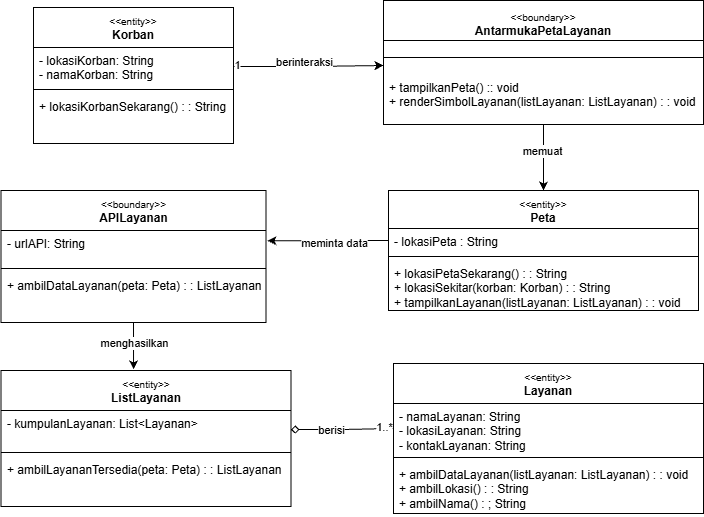
</p>
<p align="center">
<i>Gambar 9. Diagram Kelas Melihat Peta Layanan Terdekat</i>
</p>

Pada diagram, pastikan:
- Atribut dituliskan beserta visibilitas dan tipe datanya, misalnya `- email: String`.
- Operasi dituliskan beserta visibilitas, parameter, dan tipe kembaliannya, misalnya `+ login(email: String, password: String): Boolean`.
- Relasi antarkelas (asosiasi, agregasi, komposisi, generalisasi, dan dependensi) digambarkan lengkap dengan multiplisitas.
- Semua operasi yang dipanggil pada sequence diagram 3.1.2 (skenario normal dan alternatif) ada pada kelas yang bersangkutan.
- Kelas yang sama dengan kelas di use case lain memakai nama, atribut, dan metode yang konsisten.

## 3.3 Use Case Memilih Layanan Terdekat

**ID Use Case:** *UC03*  
**Nama Use Case:** *Memilih Layanan Terdekat*

### 3.3.1 Identifikasi Kelas

Tabel 3.3. Identifikasi Kelas Use Case UC01

| No | Nama Kelas Perancangan | Nama Kelas Analisis Terkait |
|:--- | :--- | :--- |
| 1 | *Korban* | *Korban* |
| 2 | *Peta* | *Peta* |
| 3 | *ListLayanan* | *ListLayanan* | 
| 4 | *Layanan* | *Layanan* |
| 5 | *APILayanan* | *APILayanan* |


### 3.3.2 Sequence Diagram

- **Skenario Normal**

<p align="center">
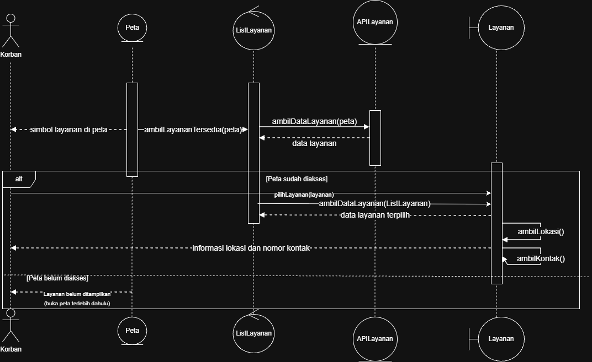
</p>
<p align="center">
<i>Gambar 10. Sequence Diagram UC03</i>
</p>

- **Skenario Alternatif 1:Informasi yang Dipanggil API Tidak Lengkap**

<p align="center">
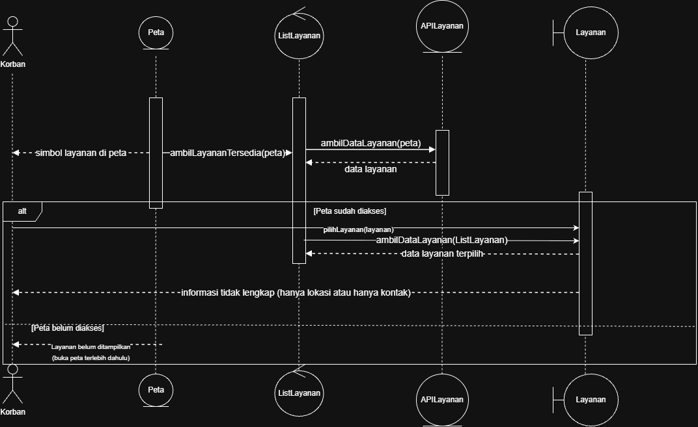
</p>
<p align="center">
<i>Gambar 11. Sequence Diagram UC03 - Informasi yang Dipanggil API Tidak Lengkap</i>
</p>

### 3.3.3 Diagram Kelas

<p align="center">
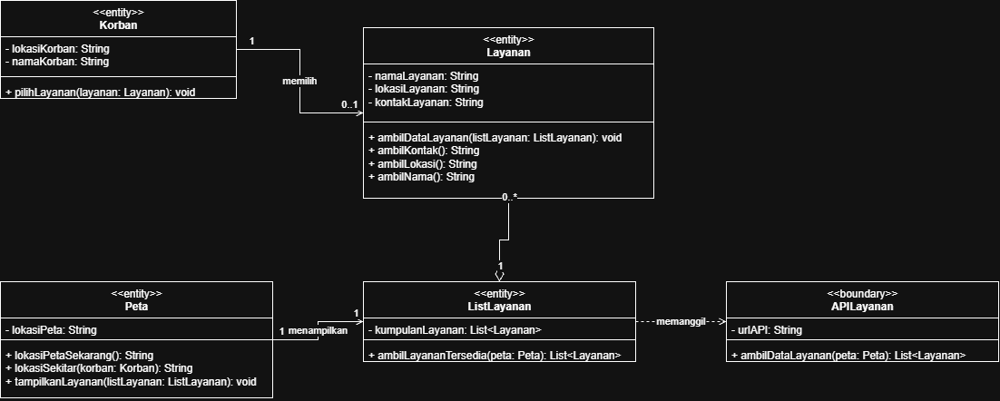
</p>
<p align="center">
<i>Gambar 12. Diagram Kelas Memilih Layanan Terdekat</i>
</p>

## 3.4 Use Case 

**ID Use Case:** *UC04*  
**Nama Use Case:** *Menghubungi Layanan Terdekat*

### 3.4.1 Identifikasi Kelas

Tabel 3.4. Identifikasi Kelas Use Case UC01

| No | Nama Kelas Perancangan | Nama Kelas Analisis Terkait |
|:--- | :--- | :--- |
| 1 | *Korban* | *Korban* |
| 2 | *Layanan* | *Layanan* |
| 3 | *AntarmukaTelepon* | *AntarmukaTelepon* | 
| 4 | *ListLayanan* | *ListLayanan* |
| 5 | *APILayanan* | *APILayanan* |

### 3.4.2 Sequence Diagram

- **Skenario Normal**

<p align="center">
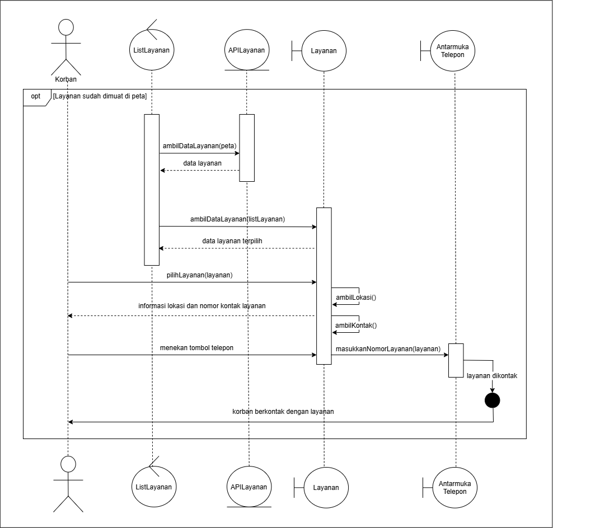
</p>
<p align="center">
<i>Gambar 13. Sequence Diagram UC04</i>
</p>

- **Skenario Alternatif 1: Informasi Kontak Tidak Tersedia**

<p align="center">
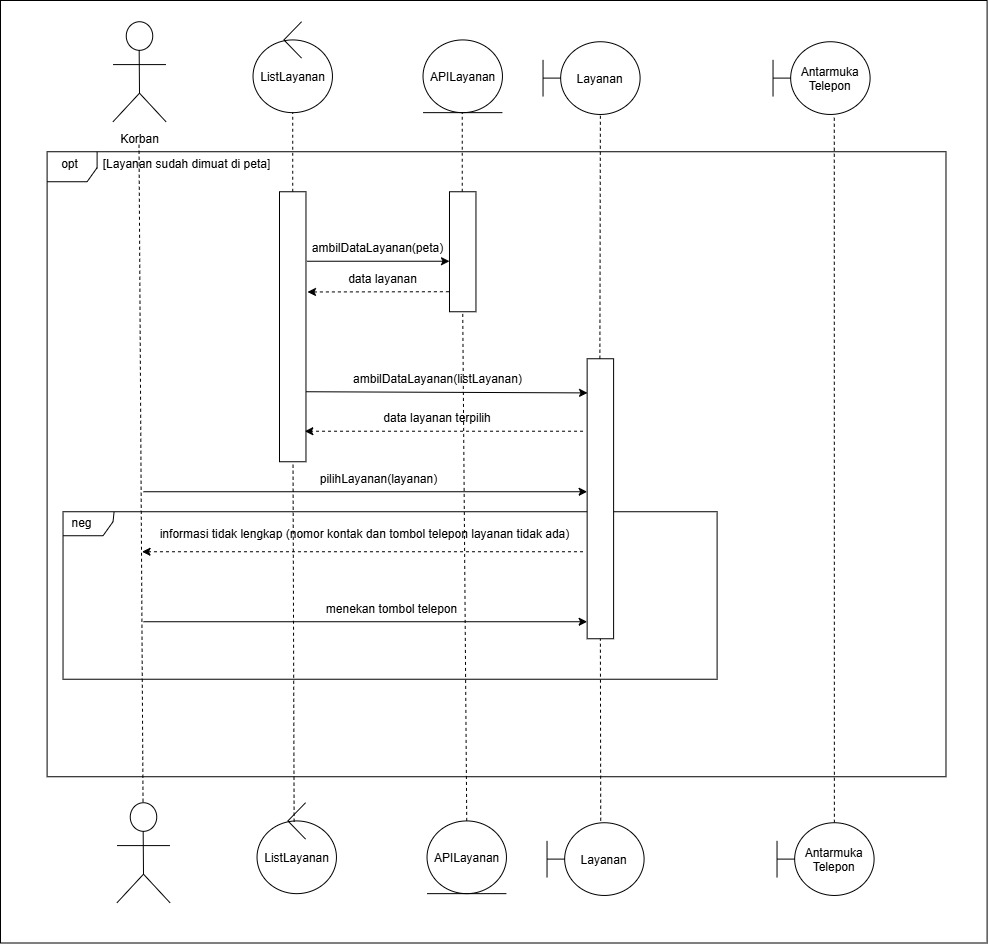
</p>
<p align="center">
<i>Gambar 14. Sequence Diagram UC04 - Informasi Kontak Tidak Tersedia</i>
</p>

### 3.4.3 Diagram Kelas

<p align="center">
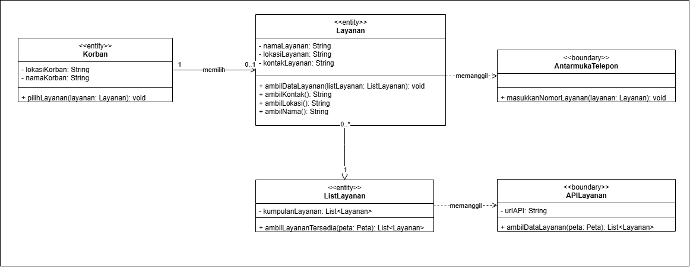
</p>
<p align="center">
<i>Gambar 15. Diagram Kelas Menghubungi Layanan Terdekat</i>
</p>

## 3.5 Use Case 

**ID Use Case:** *UC05*  
**Nama Use Case:** *Membuat Laporan Kekerasan*

### 3.5.1 Identifikasi Kelas

Tabel 3.5. Identifikasi Kelas Use Case UC01

| No | Nama Kelas Perancangan | Nama Kelas Analisis Terkait |
|:--- | :--- | :--- |
| 1 | *Korban* | *Korban* |
| 2 | *Polisi* | *Polisi* |
| 3 | *LaporanKekerasan* | *LaporanKekerasan* | 

### 3.5.2 Sequence Diagram

- **Skenario Normal**

<p align="center">

</p>
<p align="center">
<i>Gambar 16. Sequence Diagram UC05</i>
</p>

- **Skenario Alternatif 1: Formulir tidak lengkap**

<p align="center">

</p>
<p align="center">
<i>Gambar 17. Sequence Diagram UC05 - Formulir tidak lengkap</i>
</p>

### 3.5.3 Diagram Kelas

<p align="center">

</p>
<p align="center">
<i>Gambar 18. Diagram Kelas Membuat Laporan Kekerasan</i>
</p>

## 3.6 Use Case Merekam Suara Otomatis Ketika One Click SOS Diaktifkan

**ID Use Case:** *UC06*  
**Nama Use Case:** *Merekam Suara Otomatis Ketika One Click SOS Diaktifkan*

### 3.6.1 Identifikasi Kelas

Tabel 3.6. Identifikasi Kelas Use Case UC01

| No | Nama Kelas Perancangan | Nama Kelas Analisis Terkait |
|:--- | :--- | :--- |
| 1 | *OneClickSOS* | *OneClickSOS* |
| 2 | *Rekaman* | *Rekaman* |

### 3.6.2 Sequence Diagram

- **Skenario Normal**

<p align="center">

</p>
<p align="center">
<i>Gambar 19. Sequence Diagram UC06</i>
</p>

- **Skenario Alternatif 1: Mikrofon Gawai Korban Tidak Dapat Diaktifkan**

<p align="center">

</p>
<p align="center">
<i>Gambar 20. Sequence Diagram UC06 - Merekam Suara Otomatis Ketika One Click SOS Diaktifkan</i>
</p>

### 3.6.3 Diagram Kelas

<p align="center">

</p>
<p align="center">
<i>Gambar 21. Diagram Kelas [Nama Uce Case]</i>
</p>

## 3.7 Mengirim Notifikasi Konfirmasi Polisi Ke Korban

**ID Use Case:** *UC01*  
**Nama Use Case:** *Mengirim Notifikasi Konfirmasi Polisi Ke Korban*

### 3.7.1 Identifikasi Kelas

Tabel 3.7. Identifikasi Kelas Use Case UC01

| No | Nama Kelas Perancangan | Nama Kelas Analisis Terkait |
|:--- | :--- | :--- |
| 1 | *OneClickSOS* | *OneClickSOS* |
| 2 | *AntarmukaPolisi* | *AntarmukaPolisi* |
| 3 | *Korban* | *Korban* | 
| 4 | *Polisi* | *Polisi* |

### 3.7.2 Sequence Diagram

- **Skenario Normal**

<p align="center">
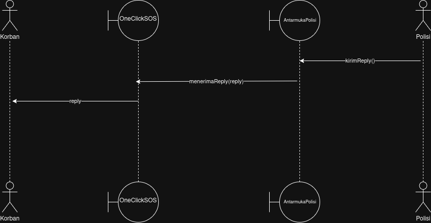
</p>
<p align="center">
<i>Gambar 22. Sequence Diagram UC07</i>
</p>

- **Skenario Alternatif 1: Kendala Jaringan dan Gagal Terhubung Ke Server**

<p align="center">
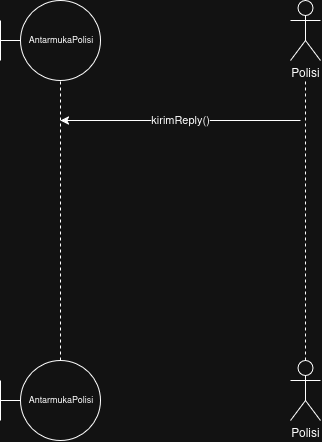
</p>
<p align="center">
<i>Gambar 23. Sequence Diagram UC07 - Kendala Jaringan dan Gagal Terhubung Ke Server</i>
</p>

### 3.7.3 Diagram Kelas

<p align="center">

</p>
<p align="center">
<i>Gambar 24. Diagram Kelas Mengirim Notifikasi Konfirmasi Polisi Ke Korban</i>
</p>

<br>

---

# BAB 4: Diagram Kelas Keseluruhan

## 4.1 Diagram Kelas

<p align="center">
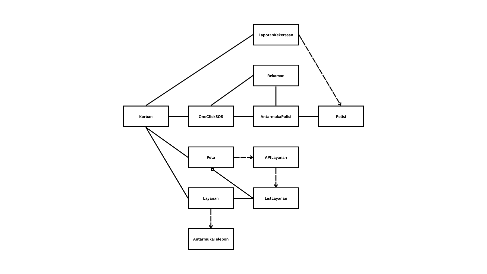
</p>
<p align="center">
<i>Gambar 25. Diagram Kelas Perancangan Keseluruhan SafeShe</i>
</p>

Tabel 4.1. Daftar Kelas Perancangan Keseluruhan

| ID Kelas | Nama Kelas | Atribut | Metode/Operasi |
| :--- | :--- | :--- | :--- |
| *C01* | *OneClickSOS* | *-* | *menerimaReply(reply), signalMikrofon(), dapatLokasi(), kirimSinyal(lokasi)* |
| *C02* | *AntarmukaPolisi* | *-* | *menerimaSinyal(signal), kirimReply()* |
| *C03* | *Korban* | *lokasiKorban, namaKorban* | *lokasiKorbanSekarang(), panggilSOS(oneclicksos), pilihLayanan(layanan), teleponLayanan(layanan)* |
| *C04* | *Peta*  | *lokasiPeta* | *lokasiPetaSekarang(), lokasiSekitar(korban), tampilkanLayanan(listLayanan)* | 
| *C05* | *ListLayanan* | *kumpulanLayanan* | *ambilLayananTersedia(peta)* |
| *C06* | *Layanan* | *namalayanan, lokasiLayanan, kontakLayanan* | *ambilDataLayanan(ListLayanan), ambilKontak(), ambilLokasi(), ambilNama()* |
| *C07* | *AntarmukaTelepon* | *-* | *masukkanNomorLayanan(layanan)* |
| *C08* | *Polisi* | *lokasiPolisi, ketersediaan* | *pantauAntarmuka(antarmukaPolisi), terimaLaporan(laporanKekerasan), kirimPasukan()* |
| *C09* | *Rekaman* | *rekamanSuara* | *mulaiRekamanSuara(), simpanRekamanSuara()* |
| *C10* | *LaporanKekerasan* | *deskripsiKekerasan, tanggalKekerasan, lokasiKekerasan, modePelapor* | *masukkanDeskripsi(), masukkanTanggal(), masukkanLokasi(), masukkanMode()* |
| *C11* | *APILayanan* | *urlAPI* | *ambilDataLayanan(peta)* |

<br>

---

# BAB 5: Matriks Kerunutan

Tabel 5.1. Matriks Kerunutan Kelas terhadap Use Case

| Kelas | Use Case Terkait |
| :--- | :--- |
| *C01 - OneClickSOS* | *UC01 - Mengaktifkan one click SOS, UC06 - Merekam Suara Otomatis Ketika One Click SOS Diaktifkan, UC07 - Mengirim Notifikasi Konfirmasi Polisi Ke Korban* | 
| *C02 - AntarmukaPolisi* | *UC01 - Mengaktifkan one click SOS, UC06 - Merekam Suara Otomatis Ketika One Click SOS Diaktifkan, UC07 - Mengirim Notifikasi Konfirmasi Polisi Ke Korban* | 
| *C03 - Korban* | *UC01 - Mengaktifkan one click SOS, UC04 - Menghubungi Layanan Terdekat, UC05 - Membuat Laporan Kekerasan, UC07 - Mengirim Notifikasi Konfirmasi Polisi Ke Korban* | 
| *C04 - Peta* | *UC02 - Melihat Peta Layanan Terdekat, UC03 - Memilih Layanan Terdekat, UC04 - Menghubungi Layanan Terdekat* | 
| *C05 - ListLayanan* | *UC02 - Melihat Peta Layanan Terdekat, UC03 - Memilih Layanan Terdekat, UC04 - Menghubungi Layanan Terdekat* | 
| *C06 - Layanan* | *UC02 - Melihat Peta Layanan Terdekat, UC03 - Memilih Layanan Terdekat, UC04 - Menghubungi Layanan Terdekat* | 
| *C07 - AntarmukaTelepon* | *UC04 - Menghubungi Layanan Terdekat* | 
| *C08 - Polisi* | *UC01 - Mengaktifkan one click SOS, UC05 - Membuat Laporan Kekerasan, UC07 - Mengirim Notifikasi Konfirmasi Polisi Ke Korban* | 
| *C09 - LaporanKekerasan* | *UC06 - Merekam Suara Otomatis Ketika One Click SOS Diaktifkan* | 
| *C10 - APILayanan* | *UC05 - Membuat Laporan Kekerasan* |
