<h1>
IF2150 REKAYASA PERANGKAT LUNAK
<br>
TUGAS 5
<br>
DESKRIPSI PERANCANGAN PERANGKAT LUNAK (DPPL)
</h1>
<br>

## *SafeShe*
### *[Logo Perangkat Lunak]*

### Untuk: *Aurelia Jennifer Gunawan*

Dipersiapkan oleh:
| Informasi | Keterangan |
| --- | --- |
| Kelas | *K2* |
| Kelompok | *10*  |

| NIM | Nama |
|---|---|
| *13525083* | *Natanael Chris Fabian Santoso* |
| *13525131* | *Mirza Aryasatya Akmal* |
| *13525149* | *Ferdinand Valentino Darmawan* |
| *13525050* | *Jason Hartanto* |
| *13525065* | *Christopher Hendrik Gunawan* |
---

## Daftar Perubahan

| Revisi | Deskripsi |
| :--- | :--- |
| *A* | *Deskripsikan perubahan yang dilakukan dari dokumen sebelumnya pada dokumen ini. Jika tidak terdapat perubahan, harap kosongkan tabel.* |
| *B* |  |
| *C* |  |
| ... |  |

---

<br>

> **Petunjuk pengerjaan:** *[Silahkan hapus bagian ini setelah selesai mengerjakan]*
>
> Dokumen ini melanjutkan **Deskripsi Perancangan Perangkat Lunak**. Gunakan nama, ID, kebutuhan, dan use case yang konsisten dengan kedua dokumen tersebut. Contoh pola ID baru di bawah dapat disesuaikan dengan kesepakatan kelompok, ID yang sudah ada tetap dipertahankan.

<br>

---


# BAB 1: Pendahuluan

## 1.1 Tujuan Penulisan Dokumen
Dokumen DPPL2 ini dibuat untuk mendeskripsikan dengan detail mengenai berbagai aspek dari perangkat lunak SafeShe agar semuanya memiliki spesifikasi yang jelas sebelum dikembangkan. Dokumen ini diperuntukkan untuk para pengembang perangkat lunak SafeShe dan asisten sebagai salah satu pemangku kepentingan dari pengimplementasian perangkat lunak yang dilakukan oleh para pengembang.

## 1.2 Lingkup Masalah
Aplikasi SafeShe adalah aplikasi yang menyediakan pelaporan kekerasan seksual yang dialami perempuan secara anonim. Aplikasi ini dibuat agar menjadi salah satu solusi untuk mengatasi proses pelaporan dan pendampingan korban dari kekerasan seksual di Indonesia yang masih reaktif dan tidak terintegrasi secara digital. SafeShe akan menyediakan fitur pelaporan anonim yang terenkripsi *end-to-end* dan memiliki peta *real-time* untuk menampilkan fasilitas layanan yang dapat dibutuhkan korban, seperti fasilitas rumah sakit dan konseling. SafeShe juga menyediakan fitur *one-click SOS* untuk memudahkan korban dalam meminta bantuan secara diam-diam dengan konfirmasi balik yang tidak mudah diketahui orang lain ketika bantuan sedang dalam perjalanan menuju lokasi korban. Selain itu, SafeShe akan merekam audio di sekitar korban setelah *one-click SOS* dipencet yang dapat membantu dalam memberikan bukti konkret untuk membantu pembuatan kasus terhadap pelaku kekerasan seksual.

## 1.3 Definisi, Istilah, dan Singkatan
Semua definisi dan singkatan yang digunakan dalam dokumen ini beserta penjelasannya.

Tabel 1.3. Definisi Istilah dan Singkatan

| Singkatan, Akronim, atau Istilah | Penjelasan |
| :--- | :--- |
| *P/L* | *Singkatan dari Perangkat Lunak, yaitu aplikasi yang memberikan perintah kepada komputer untuk menjalankan tugas tertentu.* |
| *SKPL* | *Singkatan dari Spesifikasi Kebutuhan Perangkat Lunak, yaitu dokumen yang merangkum kriteria-kriteria yang diperlukan untuk membangun aplikasi menjalankan tugasnya.* |
| *KF* | *Singkatan dari Kebutuhan Fungsional.* |
| *KNF* | *Singkatan dari Kebutuhan Non-Fungsional.* |
| *UC* | *Singkatan dari Use Case.* |
| *EARS* | *Easy Approach to Requirements Syntax, yaitu pola penulisan kebutuhan agar konsisten dan mudah diuji.* |

## 1.4 Aturan Penomoran

Tabel 1.4. Aturan Penomoran

| Hal/Bagian | Penomoran | Keterangan |
| :--- | :--- | :--- |
| *Kebutuhan Fungsional* | *KFXX* | *"KF" dilanjutkan dengan nomor id* |
| *Kebutuhan Non-Fungsional* | *KNFXX* | *"KNF" dilanjutkan dengan nomor id* |
| *Aktor* | *AXX* | *"A" dilanjutkan dengan nomor id* |
| *Use Case* | *UCXX* | *"UC" dilanjutkan dengan nomor id* |
| *Kelas* | *CXX* | *"C" dilanjutkan nomor id* |
| *User* | *US-XX* | *"US-" dilanjutkan dengan nomor id* |
| *Requirement* | *RXX* | *"R" dilanjutkan dengan nomor id* |
| *Algoritma* | *Algo-XX* | *"Algo" dilanjutkan dengan nomor id* |
| *Query* | *Q-XX* | *"Q" dilanjutkan dengan nomor id* | 
| *Objek* | *O-XX* | *"O" dilanjutkan dengan nomor id* | 
| *Tampilan Antarmuka* | *I-XX* | *"I" dilanjutkan dengan nomor id* | 


## 1.5 Referensi
Mayoritas dari BAB 1 berasal dari dokumen SKPL, BAB 2 berasal dari dokumen APL, BAB 3 menggunakan dokumen SKPL sebagai rancangan awal dari apa saja yang perlu dibuat di dalamnya, serta BAB 4 dan 5 berasal dari dokumen SKPL.

## 1.6 Deskripsi Umum Dokumen (Ikhtisar)
BAB 1 membahas pendahuluan dokumen berupa informasi umum dari dokumen, BAB 2 membahas perancangan arsitektur yang digunakan untuk pengembangan SafeShe, BAB 3 membahas rincian dari setiap use case yang disertai dengan diagram kelas dan sequence diagramnya, BAB 4 membahas diagram kelas dari keseluruhan use case, dan BAB 5 membahas Kerunutan dari setiap kelas yang ada dengan use case yang berkaitan.

<br>

---

# BAB 2: Perancangan Arsitektur

## 2.1 Rancangan Lingkungan Implementasi

| Komponen | Spesifikasi |
| :--- | :--- |
| *Server* | *Lingkungan Linux (Docker) yang dihosting pada layanan cloud (AWS/Google Cloud/Azure). Bahasa Python (FastAPI) dengan API Gateway* |
| *Client* | *React Native, penyimpanan lokal dengan SQLite, react-native-fs library* |
| *DBMS* | *PostgreSQL* |
| *OS* | *Cross-platform Android dan iOS* |

## 2.2 Style/Pattern Arsitektur Acuan

*Architectural Style* yang dipilih berdasarkan karakteristik P/L kami adalah **Decoupled Client-Server**, dengan model **Offline-First** pada *client* dan **Layered Modular** pada server.

Dari sisi *client*, P/L harus dapat mengirimkan laporan secara langsung untuk diproses walaupun pengguna dalam area tanpa akses ke internet. Ketika pengguna melaporkan kasus, React Native akan menyimpan *payload* yang terenkripsi ke SQLite. SQLite lalu secara cepat mengirimkan *payload* tersebut ke server ketika OS dari perangkat pengguna mendapatkan koneksi internet apapun. Setelah server menerima, *client* menghapus data SQLite demi keamanan.

Style yang dipilih dalam sisi server mengutamakan keistimewaan FastAPI dalam desain modular. Hal ini memungkinkan server terdiri dari beberapa lapisan *microservices*. Secara keseluruhan, P/L harus memprioritaskan dapat mengirimkan dan menerima laporan dalam situasi apapun, dan *style* dipilih berdasarkan kebutuhan tersebut.

Style yang dipilih memikirkan juga bawaan style dari teknologi yang dipakai. Contohnya, FastAPI secara bawaan mendukung *asynchronous programming*. Hal tersebut memungkinkan server secara cepat menerima dan memproses laporan yang baru saja dibuat oleh pengguna dan mengirimkan status ```202 Accepted``` ke *client* tanpa terganggu proses di latar belakang (*background processes*).

<p align="center">

</p>
<p align="center">
<i>Gambar 1. Contoh Arsitektur MVC</i>
</p>

## 2.3 Identifikasi Komponen / Modul / Subsistem

Tabel 2.3. Identifikasi Komponen/Modul/Subsistem

| Nama Komponen/Modul/Subsistem | Jenis                 | Penjelasan                                                                                                           |
| :---------------------------- | :-------------------- | :------------------------------------------------------------------------------------------------------------------- |
| *AntarmukaSOS* | *View* | *Menampilkan interface SOS SafeShe* |
| *AntarmukaPetaLayanan* | *View* | *Menampilkan peta dengan lokasi layanan* |
| *AntarmukaLaporan* | *View* | *Menampilkan detail formulir laporan kekerasan dan meneruskannya ke LaporanController* |
| *SOSController* | *Controller* | *Mengendalikan proses pengiriman signal SOS* |
| *PetaLayananController* | *Controller* | *Mengendalikan backend peta* |
| *LaporanController* | *Controller* | *Mengendalikan proses pembuatan laporan kekerasan dimulai dari menerima input dari AntarmukaLaporan, memeriksanya melalui ValidasiLaporan, lalu meneruskan laporan ke Polisi* |
| *OneClickSOS* | *Model* | *Fitur utama dari SafeShe* |
| *Korban* | *Model* | *Representasi data korban, seperti nama dan lokasi* |
| *Polisi* | *Model* | *Representasi data pihak polisi yang merespons SOS, seperti lokasi dan ketersediaan* |
| *Rekaman* | *Model* | *Data audio yang terekam* |
| *Peta* | *Model* | *Representasi data peta di sekitar korban* |
| *ListLayanan* | *Model* | *Representasi layanan-layanan terdekat yang diperoleh dari API layanan* |
| *Layanan* | *Model* | *Representasi layanan yang ada di database* |
| *LaporanKekerasan* | *Model* | *Representasi detail laporan kekerasan* |
| *ValidasiLaporan* | *Pendukung* | *Memvalidasi input formulir laporan sebelum diproses oleh LaporanController* |
| *PenyimpananLokal* | *Penyimpanan Data* | *Menyimpan rekaman secara lokal di device* |
| *SafeSheAPI* | *Komponen Backend* | *Backend FastAPI yang menghubungkan aplikasi dengan database dan sistem polisi* |
| *AntarmukaTelepon* | *Integrasi Perangkat* | *Representasi dari perangkat lunak telepon yang ada di device* |
| *SistemPolisi* | *Sistem Eksternal* | *Sistem sisi kepolisian yang menerima SOS, lokasi, dan rekaman, serta mengirim konfirmasi ke korban* |

## 2.4 Model Arsitektur Perangkat Lunak

### 2.4.1 Logical

Logical View sebagai model arsitektur perangkat lunak yang lebih berfokus pada kebutuhan fungsional dari sistem mampu mendeskripsikan layanan atau fungsionalitas-fungsionalitas yang diberikan sistem kepada user. Model Logical View mampu menjabarkan kebutuhan sistem kepada user yang berbentuk komponen-komponen teknis (class, object, API, module). Logical View juga dapat direpresentasikan menggunakan Class Diagram, Sequence Diagram, atau Diagram Komunikasi.

Alasan Logical View dipilih untuk rancangan perangkat lunak SafeShe diantaranya:
1. Logical View mampu memapping fungsionalitas dari sistem menjadi modul-modul yang terpisah secara jelas dan saling berkaitan.
2. Logical View berfokus kepada use case dan bergantung pada aksi dari aktor utamanya (korban dan polisi).
3. Logical View mampu mendukung analisis keamanan dan privasi data dengan struktur internal yang tidak terikat infrastruktur fisik.
4. Logical View selaras dengan rancangan spek dan desain SafeShe yang sebagian besar sudah menggunakan Class Diagram.  

<p align="center">
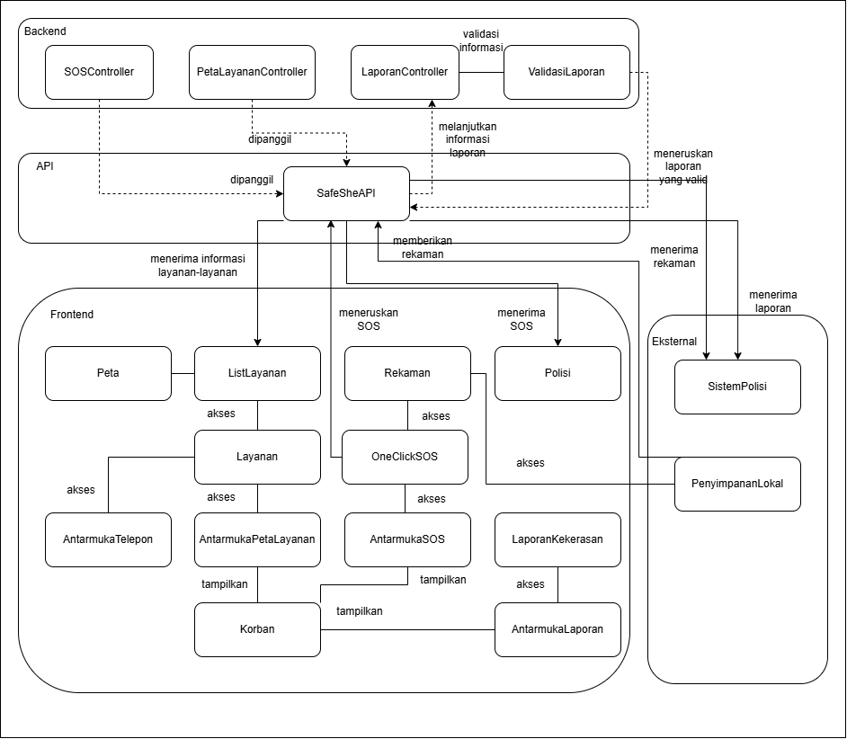
</p>
<p align="center">
<i>Gambar 2. Logical View pada SafeShe</i>
</p>


<br>

---


# BAB 3: Realisasi Use Case

## 3.1 Use Case Mengaktifkan One-Click SOS

**ID Use Case:** *UC01*  
**Nama Use Case:** *Mengaktifkan one click SOS*

### 3.1.1 Identifikasi Kelas

Tabel 3.1. Identifikasi Kelas Use Case UC01

| No | Nama Kelas Perancangan | Nama Kelas Analisis Terkait |
|:--- | :--- | :--- |
| 1 | *OneClickSOS* | *OneClickSOS* |
| 2 | *AntarmukaPolisi* | *AntarmukaPolisi* |
| 3 | *Korban* | *Korban* | 
| 4 | *Polisi* | *Polisi* |

### 3.1.2 Sequence Diagram

- **Skenario Normal**

<p align="center">
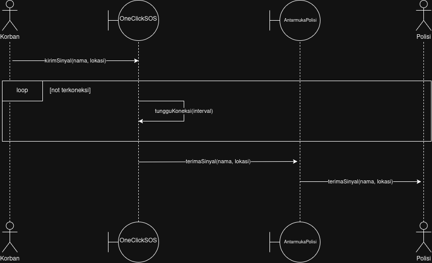
</p>
<p align="center">
<i>Gambar 3. Sequence Diagram UC01</i>
</p>

- **Skenario Alternatif 1: One Click SOS Tidak Dapat Ditampilkan Sebagai Widget Aplikasi**

<p align="center">
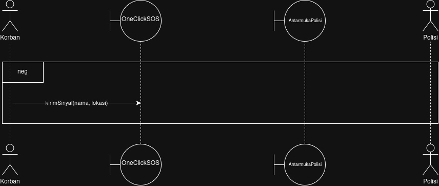
<p align="center">
<i>Gambar 4. Sequence Diagram UC01 - One Click SOS Tidak Dapat Ditampilkan Sebagai Widget Aplikasi</i>
</p>

- **Skenario Alternatif 2: One Click SOS Tidak Berhasil Mengirimkan Informasi Keadaan Ke Pihak Berwajib**

<p align="center">
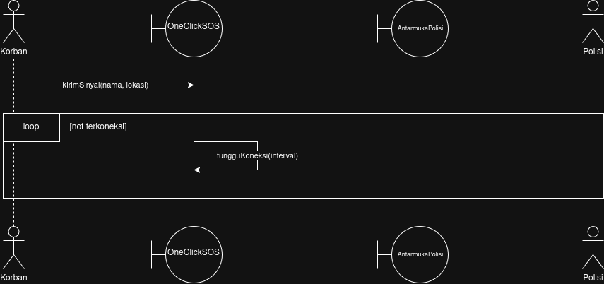
</p>
<p align="center">
<i>Gambar 5. Sequence Diagram UC01 - One Click SOS Tidak Berhasil Mengirimkan Informasi Keadaan Ke Pihak Berwajib</i>
</p>

### 3.1.3 Diagram Kelas

<p align="center">
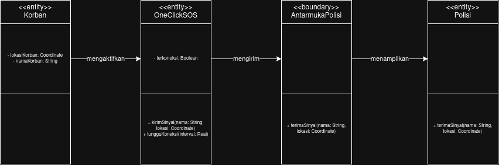
</p>
<p align="center">
<i>Gambar 6. Diagram Kelas Mengaktifkan one click SOS</i>
</p>

## 3.2 Use Case 

**ID Use Case:** *UC02*  
**Nama Use Case:** *Melihat Peta Layanan Terdekat*

### 3.2.1 Identifikasi Kelas

Tabel 3.2. Identifikasi Kelas Use Case UC02

| No | Nama Kelas Perancangan | Nama Kelas Analisis Terkait |
|:--- | :--- | :--- |
| 1 | *Korban* | *Korban* |
| 2 | *AntarmukaPetaLayanan* | *AntarmukaPetaLayanan* |
| 3 | *Peta* | *Peta* |
| 4 | *ListLayanan* | *ListLayanan* | 
| 5 | *Layanan* | *Layanan* |
| 6 | *APILayanan* | *APILayanan* |

### 3.2.2 Sequence Diagram

- **Skenario Normal**

<p align="center">

</p>
<p align="center">
<i>Gambar 7. Sequence Diagram UC02</i>
</p>

- **Skenario Alternatif 1: API Tidak Dapat Dipanggil**

<p align="center">
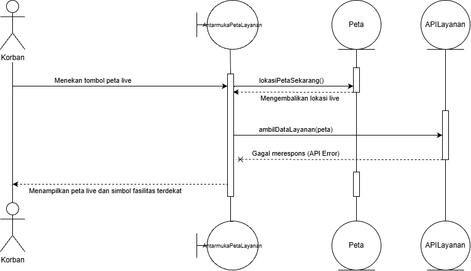
</p>
<p align="center">
<i>Gambar 8. Sequence Diagram UC02 - API Tidak Dapat Dipanggil</i>
</p>

### 3.2.3 Diagram Kelas

<p align="center">

</p>
<p align="center">
<i>Gambar 9. Diagram Kelas Melihat Peta Layanan Terdekat</i>
</p>

## 3.3 Use Case Memilih Layanan Terdekat

**ID Use Case:** *UC03*  
**Nama Use Case:** *Memilih Layanan Terdekat*

### 3.3.1 Identifikasi Kelas

Tabel 3.3. Identifikasi Kelas Use Case UC01

| No | Nama Kelas Perancangan | Nama Kelas Analisis Terkait |
|:--- | :--- | :--- |
| 1 | *Korban* | *Korban* |
| 2 | *Peta* | *Peta* |
| 3 | *ListLayanan* | *ListLayanan* | 
| 4 | *Layanan* | *Layanan* |
| 5 | *APILayanan* | *APILayanan* |


### 3.3.2 Sequence Diagram

- **Skenario Normal**

<p align="center">
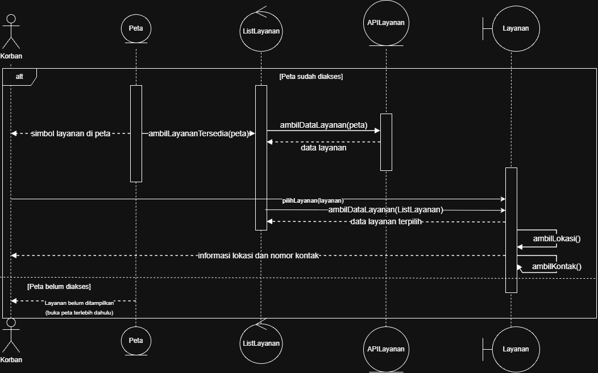
</p>
<p align="center">
<i>Gambar 10. Sequence Diagram UC03</i>
</p>

- **Skenario Alternatif 1:Informasi yang Dipanggil API Tidak Lengkap**

<p align="center">
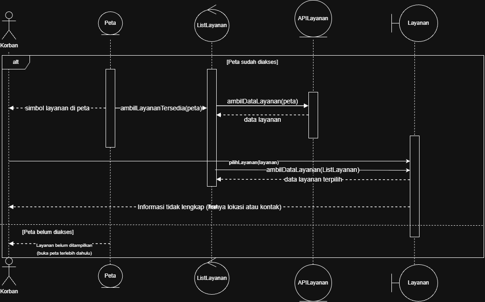
</p>
<p align="center">
<i>Gambar 11. Sequence Diagram UC03 - Informasi yang Dipanggil API Tidak Lengkap</i>
</p>

### 3.3.3 Diagram Kelas

<p align="center">

</p>
<p align="center">
<i>Gambar 12. Diagram Kelas Memilih Layanan Terdekat</i>
</p>

## 3.4 Use Case 

**ID Use Case:** *UC04*  
**Nama Use Case:** *Menghubungi Layanan Terdekat*

### 3.4.1 Identifikasi Kelas

Tabel 3.4. Identifikasi Kelas Use Case UC01

| No | Nama Kelas Perancangan | Nama Kelas Analisis Terkait |
|:--- | :--- | :--- |
| 1 | *Korban* | *Korban* |
| 2 | *Layanan* | *Layanan* |
| 3 | *AntarmukaTelepon* | *AntarmukaTelepon* | 
| 4 | *ListLayanan* | *ListLayanan* |
| 5 | *APILayanan* | *APILayanan* |

### 3.4.2 Sequence Diagram

- **Skenario Normal**

<p align="center">

</p>
<p align="center">
<i>Gambar 13. Sequence Diagram UC04</i>
</p>

- **Skenario Alternatif 1: Informasi Kontak Tidak Tersedia**

<p align="center">

</p>
<p align="center">
<i>Gambar 14. Sequence Diagram UC04 - Informasi Kontak Tidak Tersedia</i>
</p>

### 3.4.3 Diagram Kelas

<p align="center">

</p>
<p align="center">
<i>Gambar 15. Diagram Kelas Menghubungi Layanan Terdekat</i>
</p>

## 3.5 Use Case 

**ID Use Case:** *UC05*  
**Nama Use Case:** *Membuat Laporan Kekerasan*

### 3.5.1 Identifikasi Kelas

Tabel 3.5. Identifikasi Kelas Use Case UC01

| No | Nama Kelas Perancangan | Nama Kelas Analisis Terkait |
|:--- | :--- | :--- |
| 1 | *Korban* | *Korban* |
| 2 | *Polisi* | *Polisi* |
| 3 | *LaporanKekerasan* | *LaporanKekerasan* | 

### 3.5.2 Sequence Diagram

- **Skenario Normal**

<p align="center">
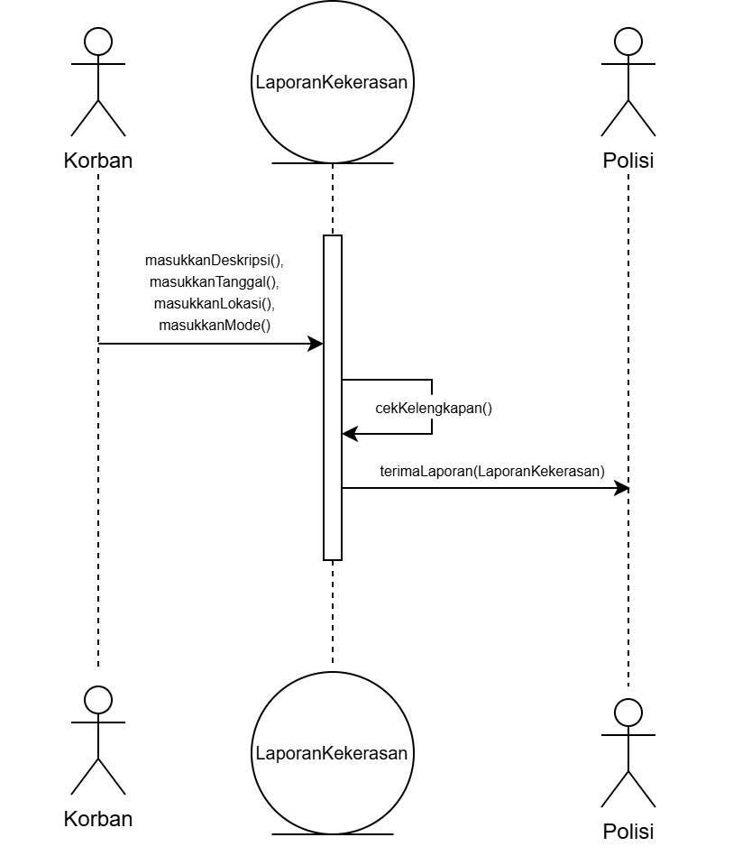
</p>
<p align="center">
<i>Gambar 16. Sequence Diagram UC05</i>
</p>

- **Skenario Alternatif 1: Formulir tidak lengkap**

<p align="center">
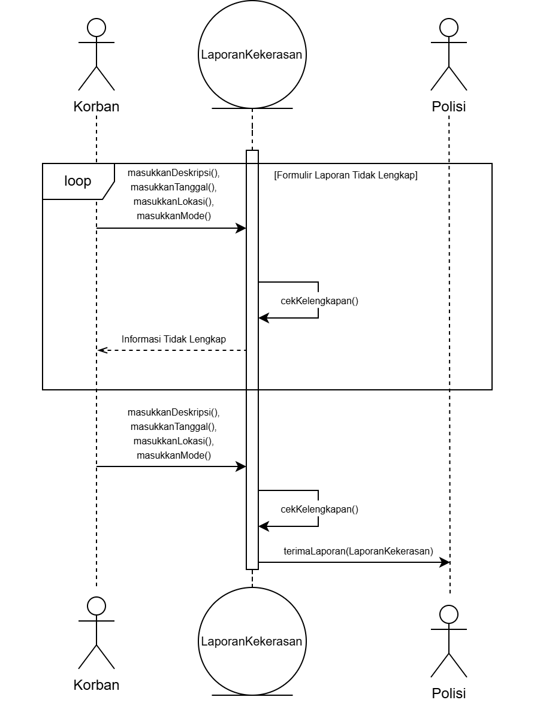
</p>
<p align="center">
<i>Gambar 17. Sequence Diagram UC05 - Formulir tidak lengkap</i>
</p>

### 3.5.3 Diagram Kelas

<p align="center">
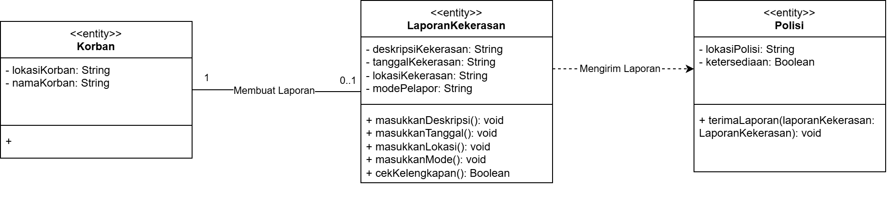
</p>
<p align="center">
<i>Gambar 18. Diagram Kelas Membuat Laporan Kekerasan</i>
</p>

## 3.6 Use Case Merekam Suara Otomatis Ketika One Click SOS Diaktifkan

**ID Use Case:** *UC06*  
**Nama Use Case:** *Merekam Suara Otomatis Ketika One Click SOS Diaktifkan*

### 3.6.1 Identifikasi Kelas

Tabel 3.6. Identifikasi Kelas Use Case UC01

| No | Nama Kelas Perancangan | Nama Kelas Analisis Terkait |
|:--- | :--- | :--- |
| 1 | *OneClickSOS* | *OneClickSOS* |
| 2 | *Rekaman* | *Rekaman* |

### 3.6.2 Sequence Diagram

- **Skenario Normal**

<p align="center">
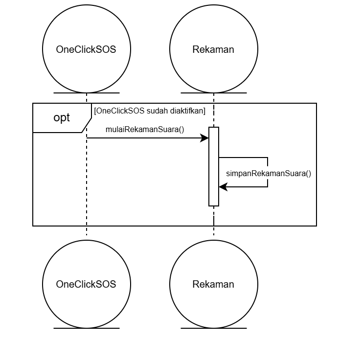
</p>
<p align="center">
<i>Gambar 19. Sequence Diagram UC06</i>
</p>

- **Skenario Alternatif 1: Mikrofon Gawai Korban Tidak Dapat Diaktifkan**

<p align="center">
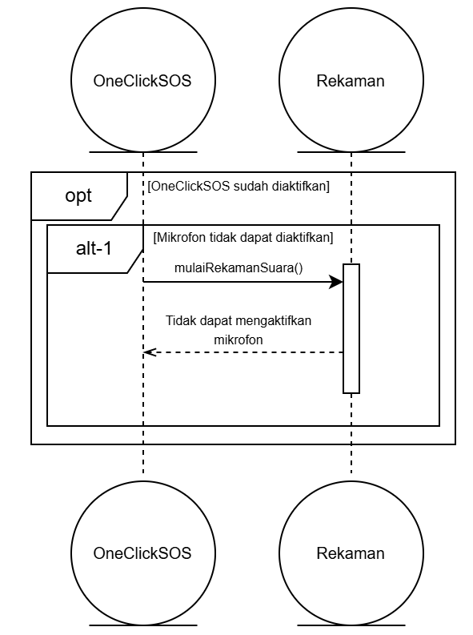
</p>
<p align="center">
<i>Gambar 20. Sequence Diagram UC06 - Mikrofon Gawai Korban Tidak Dapat Diaktifkan</i>
</p>

### 3.6.3 Diagram Kelas

<p align="center">
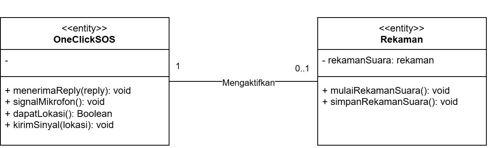
</p>
<p align="center">
<i>Gambar 21. Diagram Kelas Merekam Suara Otomatis Ketika One Click SOS Diaktifkan</i>
</p>

## 3.7 Mengirim Notifikasi Konfirmasi Polisi Ke Korban

**ID Use Case:** *UC01*  
**Nama Use Case:** *Mengirim Notifikasi Konfirmasi Polisi Ke Korban*

### 3.7.1 Identifikasi Kelas

Tabel 3.7. Identifikasi Kelas Use Case UC01

| No | Nama Kelas Perancangan | Nama Kelas Analisis Terkait |
|:--- | :--- | :--- |
| 1 | *OneClickSOS* | *OneClickSOS* |
| 2 | *AntarmukaPolisi* | *AntarmukaPolisi* |
| 3 | *Korban* | *Korban* | 
| 4 | *Polisi* | *Polisi* |

### 3.7.2 Sequence Diagram

- **Skenario Normal**

<p align="center">
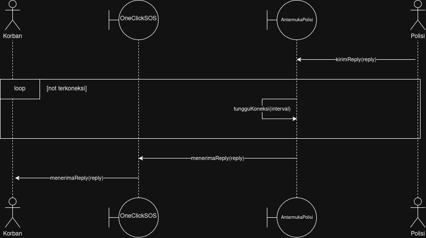
</p>
<p align="center">
<i>Gambar 22. Sequence Diagram UC07</i>
</p>

- **Skenario Alternatif 1: Kendala Jaringan dan Gagal Terhubung Ke Server**

<p align="center">
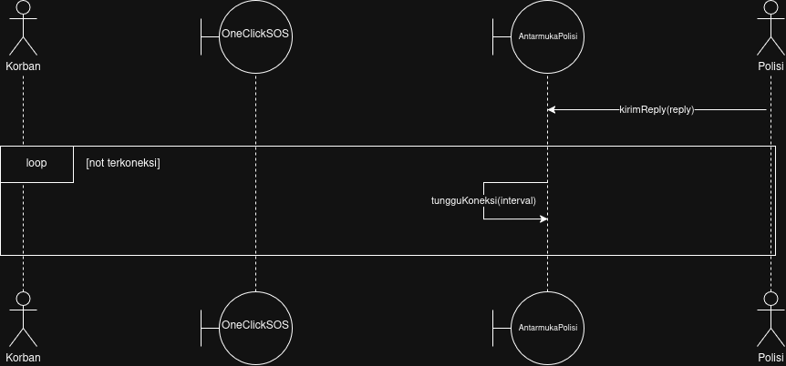
</p>
<p align="center">
<i>Gambar 23. Sequence Diagram UC07 - Kendala Jaringan dan Gagal Terhubung Ke Server</i>
</p>

### 3.7.3 Diagram Kelas

<p align="center">
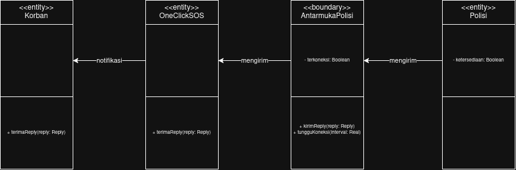
</p>
<p align="center">
<i>Gambar 24. Diagram Kelas Mengirim Notifikasi Konfirmasi Polisi Ke Korban</i>
</p>

<br>

---

# BAB 4: Diagram Kelas Keseluruhan

## 4.1 Diagram Kelas

<p align="center">

</p>
<p align="center">
<i>Gambar 25. Diagram Kelas Perancangan Keseluruhan SafeShe</i>
</p>

Tabel 4.1. Daftar Kelas Perancangan Keseluruhan

| ID Kelas | Nama Kelas | Atribut | Metode/Operasi |
| :--- | :--- | :--- | :--- |
| *C01* | *OneClickSOS* | *-* | *menerimaReply(reply), signalMikrofon(), dapatLokasi(), kirimSinyal(lokasi)* |
| *C02* | *AntarmukaPolisi* | *-* | *menerimaSinyal(signal), kirimReply()* |
| *C03* | *Korban* | *lokasiKorban, namaKorban* | *lokasiKorbanSekarang(), panggilSOS(oneclicksos), pilihLayanan(layanan), teleponLayanan(layanan)* |
| *C04* | *Peta*  | *lokasiPeta* | *lokasiPetaSekarang(), lokasiSekitar(korban), tampilkanLayanan(listLayanan)* | 
| *C05* | *ListLayanan* | *kumpulanLayanan* | *ambilLayananTersedia(peta)* |
| *C06* | *Layanan* | *namalayanan, lokasiLayanan, kontakLayanan* | *ambilDataLayanan(ListLayanan), ambilKontak(), ambilLokasi(), ambilNama()* |
| *C07* | *AntarmukaTelepon* | *-* | *masukkanNomorLayanan(layanan)* |
| *C08* | *Polisi* | *lokasiPolisi, ketersediaan* | *pantauAntarmuka(antarmukaPolisi), terimaLaporan(laporanKekerasan), kirimPasukan()* |
| *C09* | *Rekaman* | *rekamanSuara* | *mulaiRekamanSuara(), simpanRekamanSuara()* |
| *C10* | *LaporanKekerasan* | *deskripsiKekerasan, tanggalKekerasan, lokasiKekerasan, modePelapor* | *masukkanDeskripsi(), masukkanTanggal(), masukkanLokasi(), masukkanMode(), cekKelengkapan()* |
| *C11* | *APILayanan* | *urlAPI* | *ambilDataLayanan(peta)* |
| *C12* | *AntarmukaPetaLayanan* | *-* | *tampilkanPeta(), renderSimbolLayanan(listLayanan: ListLayanan)* |

<br>

---

# BAB 5: Perancangan Rinci Kelas

Tabel 5.1. Daftar Kelas Perancangan dan Kelas Analisis Terkait

| No | Nama Kelas Perancangan | Nama Kelas Analisis Terkait |
| :--- | :--- | :--- |
| 1 | *OneClickSOS* | *OneClickSOS* |
| 2 | *AntarmukaPolisi* | *AntarmukaPolisi* |
| 3 | *Korban* | *Korban* |
| 4 | *Peta* | *Peta* |
| 5 | *ListLayanan* | *ListLayanan* |
| 6 | *Layanan* | *Layanan* |
| 7 | *AntarmukaTelepon* | *AntarmukaTelepon* |
| 8 | *Polisi* | *Polisi* |
| 9 | *Rekaman* | *Rekaman* |
| 10 | *LaporanKekerasan* | *LaporanKekerasan* |
| 11 | *APILayanan* | *APILayanan* |
| 12 | *AntarmukaPetaLayanan* | *AntarmukaPetaLayanan* |
| ... | *...* | *...* |

Untuk **setiap kelas**, identifikasi operasi berdasarkan tanggung jawab kelas beserta *visibility*-nya, serta atribut beserta *visibility* dan tipenya. Buat subbab tersendiri untuk setiap kelas.

## 5.1 Kelas OneClickSOS

**Nama Kelas:** *OneClickSOS*  
**ID Kelas:** *C01*

Tabel 5.1.1. Operasi Kelas OneClickSOS

| Nama Operasi | Visibility (private, public) | Keterangan |
| :--- | :--- | :--- |
| *menerimaReply(reply: Reply): void* | *Public* | *Menerima balasan yang dikirimkan oleh pihak polisi kepada korban* |
| *kirimSinyal(nama: String, lokasi: Coordinate): void* | *Public* | *Mengirimkan sinyal berisi nama korban dan lokasi kejadian ke antarmuka polisi.* |
| *tungguKoneksi(Interval: Real): void* | *Public* | *Menunggu sampai gawai terhubung ke jaringan internet.* |
| *sinyalMikrofon(): void* | *Public* | *Memberikan sinyal ke Rekaman untuk mulai merekam.* |
| *dapatLokasi(): Boolean* | *Public* | *Mengonfirmasi apakah mendapatkan lokasi atau tidak.* |
| *...* | *...* | *...* |


Tabel 5.1.2. Atribut Kelas OneClickSOS

| Nama Atribut | Visibility (private, public) | Tipe |
| :--- | :--- | :--- |
| *terkoneksi* | *Private* | *Boolean* |
| *...* | *...* | *...* |

### 5.1.1 Algoritma/Query

Bagian ini diisi untuk kerangka algoritma proses yang dianggap cukup penting. Algoritma dapat dituliskan sebagai *pseudocode*. Implementasi *skeleton code* juga dapat digunakan untuk kelas yang sudah terdefinisi pada bahasa pemrograman tertentu.

**Nama Kelas:** *OneClickSOS*  
**Nama Operasi:** *[Signature operasi]*  
**ID Algoritma:** *[Algo-001]*

```text
[Tuliskan pseudocode algoritma operasi di sini.]
```

Jika operasi mengacu pada query tertentu, lengkapi tabel berikut. 

Tabel 5.1.1. Query Operasi [Nama Operasi]

| No Query | Query | Keterangan |
| :--- | :--- | :--- |
| *[Q-001]* | *[Tuliskan query]* | *[Fungsi query]* |
| *...* | *...* | *...* |


### 5.1.2 Algoritma/Query

*[Ulangi pola 5.1.1 untuk operasi penting berikutnya pada kelas yang sama, jika ada.]*

## 5.2 Kelas AntarmukaPolisi

**Nama Kelas:** *AntarmukaPolisi*  
**ID Kelas:** *C02*

Tabel 5.2.1. Operasi Kelas AntarmukaPolisi

| Nama Operasi | Visibility (private, public) | Keterangan |
| :--- | :--- | :--- |
| *terimaSinyal(nama: String, lokasi: Coordinate): void* | *Public* | *Menerima sinyal berisi nama korban dan lokasi kejadian dari OneClickSOS* |
| *kirimReply(reply: Reply): void* | *Public* | *Mengirimkan balasan dari polisi ke korban.* |
| *tungguKoneksi(Interval: Real): void* | *Public* | *Menunggu sampai terdapat koneksi jaringan internet.* |

Tabel 5.2.2. Atribut Kelas AntarmukaPolisi

| Nama Atribut | Visibility (private, public) | Tipe |
| :--- | :--- | :--- |
| *terkoneksi* | *Private* | *Boolean* |
| *...* | *...* | *...* |

### 5.2.1 Algoritma/Query

Bagian ini diisi untuk kerangka algoritma proses yang dianggap cukup penting. Algoritma dapat dituliskan sebagai *pseudocode*. Implementasi *skeleton code* juga dapat digunakan untuk kelas yang sudah terdefinisi pada bahasa pemrograman tertentu.

**Nama Kelas:** *AntarmukaPolisi*  
**Nama Operasi:** *[Signature operasi]*  
**ID Algoritma:** *[Algo-001]*

```text
[Tuliskan pseudocode algoritma operasi di sini.]
```

Jika operasi mengacu pada query tertentu, lengkapi tabel berikut. 

Tabel 5.1.1. Query Operasi [Nama Operasi]

| No Query | Query | Keterangan |
| :--- | :--- | :--- |
| *[Q-001]* | *[Tuliskan query]* | *[Fungsi query]* |
| *...* | *...* | *...* |


### 5.2.2 Algoritma/Query

*[Ulangi pola 5.2.1 untuk operasi penting berikutnya pada kelas yang sama, jika ada.]*

## 5.3 Kelas Korban

**Nama Kelas:** *Korban*  
**ID Kelas:** *C03*

Tabel 5.3.1. Operasi Kelas Korban

| Nama Operasi | Visibility (private, public) | Keterangan |
| :--- | :--- | :--- |
| *lokasiKorbanSekarang(): Coordinate* | *Public* | *Mengembalikan lokasi dari korban dalam bentuk koordinat.* |
| *...* | *...* | *...* |

Tabel 5.3.2. Atribut Kelas OneClickSOS

| Nama Atribut | Visibility (private, public) | Tipe |
| :--- | :--- | :--- |
| *lokasiKorban* | *Private* | *Coordinate* |
| *namaKorban* | *Private* | *String* |
| *...* | *...* | *...* |

### 5.3.1 Algoritma/Query

Bagian ini diisi untuk kerangka algoritma proses yang dianggap cukup penting. Algoritma dapat dituliskan sebagai *pseudocode*. Implementasi *skeleton code* juga dapat digunakan untuk kelas yang sudah terdefinisi pada bahasa pemrograman tertentu.

**Nama Kelas:** *Korban*  
**Nama Operasi:** *[Signature operasi]*  
**ID Algoritma:** *[Algo-001]*

```text
[Tuliskan pseudocode algoritma operasi di sini.]
```

Jika operasi mengacu pada query tertentu, lengkapi tabel berikut. 

Tabel 5.3.1. Query Operasi [Nama Operasi]

| No Query | Query | Keterangan |
| :--- | :--- | :--- |
| *[Q-001]* | *[Tuliskan query]* | *[Fungsi query]* |
| *...* | *...* | *...* |


### 5.3.2 Algoritma/Query

*[Ulangi pola 5.1.1 untuk operasi penting berikutnya pada kelas yang sama, jika ada.]*

## 5.4 Kelas Peta

**Nama Kelas:** *Peta*  
**ID Kelas:** *C04*

Tabel 5.4.1. Operasi Kelas Peta

| Nama Operasi | Visibility (private, public) | Keterangan |
| :--- | :--- | :--- |
| *lokasiPetaSekarang(): Coordinate* | *Public* | *Mengembalikan lokasi dari peta dalam bentuk koordinat.* |
| *lokasiSekitar(korban: Korban): Coordinate* | *Public* | *Mengembalikan lokasi di sekitar lokasi (koordinat) korban.* |
| *tampilkanLayanan(listLayanan: ListLayanan): void* | *Public* | *Menampilkan daftar layanan yang ada.* |
| *...* | *...* | *...* |

Tabel 5.4.2. Atribut Kelas Peta

| Nama Atribut | Visibility (private, public) | Tipe |
| :--- | :--- | :--- |
| *lokasiPeta* | *Private* | *Coordinate* |
| *...* | *...* | *...* |

### 5.4.1 Algoritma/Query

Bagian ini diisi untuk kerangka algoritma proses yang dianggap cukup penting. Algoritma dapat dituliskan sebagai *pseudocode*. Implementasi *skeleton code* juga dapat digunakan untuk kelas yang sudah terdefinisi pada bahasa pemrograman tertentu.

**Nama Kelas:** *Peta*  
**Nama Operasi:** *[Signature operasi]*  
**ID Algoritma:** *[Algo-001]*

```text
[Tuliskan pseudocode algoritma operasi di sini.]
```

Jika operasi mengacu pada query tertentu, lengkapi tabel berikut. 

Tabel 5.4.1. Query Operasi [Nama Operasi]

| No Query | Query | Keterangan |
| :--- | :--- | :--- |
| *[Q-001]* | *[Tuliskan query]* | *[Fungsi query]* |
| *...* | *...* | *...* |


### 5.4.2 Algoritma/Query

*[Ulangi pola 5.1.1 untuk operasi penting berikutnya pada kelas yang sama, jika ada.]*

## 5.5 Kelas ListLayanan

**Nama Kelas:** *ListLayanan*  
**ID Kelas:** *C05*

Tabel 5.5.1. Operasi Kelas ListLayanan

| Nama Operasi | Visibility (private, public) | Keterangan |
| :--- | :--- | :--- |
| *ambilLayananTersedia(peta: Peta): List of Layanan* | *Public* | *Mengambil layanan yang tersedia, berdasarkan layanan yang ditampilkan di peta.* |
| *...* | *...* | *...* |

Tabel 5.5.2. Atribut Kelas ListLayanan

| Nama Atribut | Visibility (private, public) | Tipe |
| :--- | :--- | :--- |
| *kumpulanLayanan* | *Private* | *List of Layanan* |
| *...* | *...* | *...* |

### 5.5.1 Algoritma/Query

Bagian ini diisi untuk kerangka algoritma proses yang dianggap cukup penting. Algoritma dapat dituliskan sebagai *pseudocode*. Implementasi *skeleton code* juga dapat digunakan untuk kelas yang sudah terdefinisi pada bahasa pemrograman tertentu.

**Nama Kelas:** *ListLayanan*  
**Nama Operasi:** *[Signature operasi]*  
**ID Algoritma:** *[Algo-001]*

```text
[Tuliskan pseudocode algoritma operasi di sini.]
```

Jika operasi mengacu pada query tertentu, lengkapi tabel berikut. 

Tabel 5.5.1. Query Operasi [Nama Operasi]

| No Query | Query | Keterangan |
| :--- | :--- | :--- |
| *[Q-001]* | *[Tuliskan query]* | *[Fungsi query]* |
| *...* | *...* | *...* |


### 5.5.2 Algoritma/Query

*[Ulangi pola 5.1.1 untuk operasi penting berikutnya pada kelas yang sama, jika ada.]*

## 5.6 Kelas Layanan

**Nama Kelas:** *Layanan*  
**ID Kelas:** *C06*

Tabel 5.6.1. Operasi Kelas Layanan

| Nama Operasi | Visibility (private, public) | Keterangan |
| :--- | :--- | :--- |
| *ambilDataLayanan(listLayanan: ListLayanan): void* | *Public* | *Mengambil data layanan dari list layanan yang tersedia.* |
| *ambilLokasi(): Coordinate* | *Public* | *Mengembalikan lokasi layanan dalam bentuk koordinat.* |
| *ambilNama(): String* | *Public* | *Mengembalikan nama layanan.* |
| *ambilKontak(): String* | *Public* | *Mengembalikan kontak dari layanan.* |
| *...* | *...* | *...* |

Tabel 5.6.2. Atribut Kelas Layanan

| Nama Atribut | Visibility (private, public) | Tipe |
| :--- | :--- | :--- |
| *namaLayanan* | *Private* | *String* |
| *lokasiLayanan* | *Private* | *Coordinate* |
| *kontakLayanan* | *Private* | *String* |
| *...* | *...* | *...* |

### 5.6.1 Algoritma/Query

Bagian ini diisi untuk kerangka algoritma proses yang dianggap cukup penting. Algoritma dapat dituliskan sebagai *pseudocode*. Implementasi *skeleton code* juga dapat digunakan untuk kelas yang sudah terdefinisi pada bahasa pemrograman tertentu.

**Nama Kelas:** *Layanan*  
**Nama Operasi:** *[Signature operasi]*  
**ID Algoritma:** *[Algo-001]*

```text
[Tuliskan pseudocode algoritma operasi di sini.]
```

Jika operasi mengacu pada query tertentu, lengkapi tabel berikut. 

Tabel 5.6.1. Query Operasi [Nama Operasi]

| No Query | Query | Keterangan |
| :--- | :--- | :--- |
| *[Q-001]* | *[Tuliskan query]* | *[Fungsi query]* |
| *...* | *...* | *...* |


### 5.6.2 Algoritma/Query

*[Ulangi pola 5.1.1 untuk operasi penting berikutnya pada kelas yang sama, jika ada.]*

## 5.7 Kelas AntarmukaTelepon

**Nama Kelas:** *AntarmukaTelepon*  
**ID Kelas:** *C07*

Tabel 5.7.1. Operasi Kelas AntarmukaTelepon

| Nama Operasi | Visibility (private, public) | Keterangan |
| :--- | :--- | :--- |
| *masukkanNomorLayanan(layanan: Layanan): void* | *Public* | *Memasukkan nomor dari layanan yang tersedia.* |
| *...* | *...* | *...* |

Tabel 5.7.2. Atribut Kelas AntarmukaTelepon

| Nama Atribut | Visibility (private, public) | Tipe |
| :--- | :--- | :--- |
| *...* | *...* | *...* |
Kelas ini tidak memiliki atribut.

### 5.7.1 Algoritma/Query

Bagian ini diisi untuk kerangka algoritma proses yang dianggap cukup penting. Algoritma dapat dituliskan sebagai *pseudocode*. Implementasi *skeleton code* juga dapat digunakan untuk kelas yang sudah terdefinisi pada bahasa pemrograman tertentu.

**Nama Kelas:** *AntarmukaTelepon*  
**Nama Operasi:** *[Signature operasi]*  
**ID Algoritma:** *[Algo-001]*

```text
[Tuliskan pseudocode algoritma operasi di sini.]
```

Jika operasi mengacu pada query tertentu, lengkapi tabel berikut. 

Tabel 5.7.1. Query Operasi [Nama Operasi]

| No Query | Query | Keterangan |
| :--- | :--- | :--- |
| *[Q-001]* | *[Tuliskan query]* | *[Fungsi query]* |
| *...* | *...* | *...* |


### 5.7.2 Algoritma/Query

*[Ulangi pola 5.1.1 untuk operasi penting berikutnya pada kelas yang sama, jika ada.]*

## 5.8 Kelas Polisi

**Nama Kelas:** *Polisi*  
**ID Kelas:** *C08*

Tabel 5.8.1. Operasi Kelas Polisi

| Nama Operasi | Visibility (private, public) | Keterangan |
| :--- | :--- | :--- |
| *terimaSinyal(nama: String, lokasi: Coordinate)* | *Public* | *Menerima sinyal berisi nama korban dan lokasi kejadian dari OneClickSOS melalui AntarmukaPolisi.* |
| *terimaLaporan(laporanKekerasan: LaporanKekerasan): void* | *Public* | *Menerima laporan kekerasan yang dikirimkan oleh korban.* |
| *...* | *...* | *...* |

Tabel 5.8.2. Atribut Kelas Polisi

| Nama Atribut | Visibility (private, public) | Tipe |
| :--- | :--- | :--- |
| *lokasiPolisi* | *Private* | *Coordinate* |
| *ketersediaan* | *Private* | *Boolean* |
| *...* | *...* | *...* |

### 5.8.1 Algoritma/Query

Bagian ini diisi untuk kerangka algoritma proses yang dianggap cukup penting. Algoritma dapat dituliskan sebagai *pseudocode*. Implementasi *skeleton code* juga dapat digunakan untuk kelas yang sudah terdefinisi pada bahasa pemrograman tertentu.

**Nama Kelas:** *Polisi*  
**Nama Operasi:** *[Signature operasi]*  
**ID Algoritma:** *[Algo-001]*

```text
[Tuliskan pseudocode algoritma operasi di sini.]
```

Jika operasi mengacu pada query tertentu, lengkapi tabel berikut. 

Tabel 5.8.1. Query Operasi [Nama Operasi]

| No Query | Query | Keterangan |
| :--- | :--- | :--- |
| *[Q-001]* | *[Tuliskan query]* | *[Fungsi query]* |
| *...* | *...* | *...* |


### 5.8.2 Algoritma/Query

*[Ulangi pola 5.1.1 untuk operasi penting berikutnya pada kelas yang sama, jika ada.]*

## 5.9 Kelas Rekaman

**Nama Kelas:** *Rekaman*  
**ID Kelas:** *C09*

Tabel 5.9.1. Operasi Kelas Rekaman

| Nama Operasi | Visibility (private, public) | Keterangan |
| :--- | :--- | :--- |
| *mulaiRekamanSuara(): void* | *Public* | *Saat OneClickSOS diaktifkan, operasi bertugas menyalakan mikrofon dan memulai rekaman suara* |
| *simpanRekamanSuara(): void* | *Public* | *Menyimpan rekaman suara ke penyimpanan gawai korban* |
| *...* | *...* | *...* |

Tabel 5.9.2. Atribut Kelas Rekaman

| Nama Atribut | Visibility (private, public) | Tipe |
| :--- | :--- | :--- |
| *rekamanSuara* | *Private* | *File (.mp3)* |
| *...* | *...* | *...* |

### 5.9.1 Algoritma/Query

Bagian ini diisi untuk kerangka algoritma proses yang dianggap cukup penting. Algoritma dapat dituliskan sebagai *pseudocode*. Implementasi *skeleton code* juga dapat digunakan untuk kelas yang sudah terdefinisi pada bahasa pemrograman tertentu.

**Nama Kelas:** *Rekaman*  
**Nama Operasi:** *[Signature operasi]*  
**ID Algoritma:** *[Algo-001]*

```text
[Tuliskan pseudocode algoritma operasi di sini.]
```

Jika operasi mengacu pada query tertentu, lengkapi tabel berikut. 

Tabel 5.9.1. Query Operasi [Nama Operasi]

| No Query | Query | Keterangan |
| :--- | :--- | :--- |
| *[Q-001]* | *[Tuliskan query]* | *[Fungsi query]* |
| *...* | *...* | *...* |


### 5.9.2 Algoritma/Query

*[Ulangi pola 5.1.1 untuk operasi penting berikutnya pada kelas yang sama, jika ada.]*

## 5.10 Kelas LaporanKekerasan

**Nama Kelas:** *LaporanKekerasan* 
**ID Kelas:** *C10*

Tabel 5.10.1. Operasi Kelas LaporanKekerasan

| Nama Operasi | Visibility (private, public) | Keterangan |
| :--- | :--- | :--- |
| *masukkanDeskripsi(): void* | *Public* | *Memasukkan input pengguna berupa deskripsi kekerasan.* |
| *masukkanTanggal(): void* | *Public* | *Memasukkan input pengguna berupa tanggal kejadian kekerasan.* |
| *masukkanLokasi(): void* | *Public* | *Memasukkan input pengguna berupa lokasi kejadian kekerasan dalam bentuk koordinat.* |
| *masukkanMode(): void* | *Public* | *Memasukkan input pengguna berupa mode pelaporan kekerasan.* |
| *cekKelengkapan(): Boolean* | *Public* | *Memeriksa kelengkapan dari input pengguna terkait laporan kekerasan.* |
| *...* | *...* | *...* |

Tabel 5.10.2. Atribut Kelas LaporanKekerasan

| Nama Atribut | Visibility (private, public) | Tipe |
| :--- | :--- | :--- |
| *deskripsiKekerasan* | *Private* | *String* |
| *tanggalKekerasan* | *Private* | *Date* |
| *lokasiKekerasan* | *Private* | *Coordinate* |
| *modePelapor* | *Private* | *String* |
| *...* | *...* | *...* |

### 5.10.1 Algoritma/Query

Bagian ini diisi untuk kerangka algoritma proses yang dianggap cukup penting. Algoritma dapat dituliskan sebagai *pseudocode*. Implementasi *skeleton code* juga dapat digunakan untuk kelas yang sudah terdefinisi pada bahasa pemrograman tertentu.

**Nama Kelas:** *LaporanKekerasan*  
**Nama Operasi:** *[Signature operasi]*  
**ID Algoritma:** *[Algo-001]*

```text
[Tuliskan pseudocode algoritma operasi di sini.]
```

Jika operasi mengacu pada query tertentu, lengkapi tabel berikut. 

Tabel 5.10.1. Query Operasi [Nama Operasi]

| No Query | Query | Keterangan |
| :--- | :--- | :--- |
| *[Q-001]* | *[Tuliskan query]* | *[Fungsi query]* |
| *...* | *...* | *...* |


### 5.10.2 Algoritma/Query

*[Ulangi pola 5.1.1 untuk operasi penting berikutnya pada kelas yang sama, jika ada.]*

## 5.11 Kelas APILayanan

**Nama Kelas:** *APILayanan*  
**ID Kelas:** *C11*

Tabel 5.11.1. Operasi Kelas APILayanan

| Nama Operasi | Visibility (private, public) | Keterangan |
| :--- | :--- | :--- |
| *ambilDataLayanan(peta: Peta): ListLayanan* | *Public* | *Mengambil data dari layanan berdasarkan layanan yang ditampilkan di peta.* |
| *...* | *...* | *...* |

Tabel 5.11.2. Atribut Kelas APILayanan

| Nama Atribut | Visibility (private, public) | Tipe |
| :--- | :--- | :--- |
| *urlAPI* | *Private* | *String* |
| *...* | *...* | *...* |

### 5.11.1 Algoritma/Query

Bagian ini diisi untuk kerangka algoritma proses yang dianggap cukup penting. Algoritma dapat dituliskan sebagai *pseudocode*. Implementasi *skeleton code* juga dapat digunakan untuk kelas yang sudah terdefinisi pada bahasa pemrograman tertentu.

**Nama Kelas:** *APILayanan*  
**Nama Operasi:** *[Signature operasi]*  
**ID Algoritma:** *[Algo-001]*

```text
[Tuliskan pseudocode algoritma operasi di sini.]
```

Jika operasi mengacu pada query tertentu, lengkapi tabel berikut. 

Tabel 5.11.1. Query Operasi [Nama Operasi]

| No Query | Query | Keterangan |
| :--- | :--- | :--- |
| *[Q-001]* | *[Tuliskan query]* | *[Fungsi query]* |
| *...* | *...* | *...* |


### 5.11.2 Algoritma/Query

*[Ulangi pola 5.1.1 untuk operasi penting berikutnya pada kelas yang sama, jika ada.]*

## 5.12 Kelas AntarmukaPetaLayanan

**Nama Kelas:** *AntarmukaPetaLayanan*
**ID Kelas:** *C12*

Tabel 5.12.1. Operasi Kelas AntarmukaPetaLayanan

| Nama Operasi | Visibility (private, public) | Keterangan |
| :--- | :--- | :--- |
| *tampilkanPeta(): void* | *Public* | *Menampilkan peta.* |
| *renderSimbolLayanan(lisLayanan: ListLayanan): void* | *Public* | *Menampilkan simbol layanan yang tersedia pada peta.* |
| *...* | *...* | *...* |

Tabel 5.12.2. Atribut Kelas AntarmukaPetaLayanan

| Nama Atribut | Visibility (private, public) | Tipe |
| :--- | :--- | :--- |
| *...* | *...* | *...* |

### 5.12.1 Algoritma/Query

Bagian ini diisi untuk kerangka algoritma proses yang dianggap cukup penting. Algoritma dapat dituliskan sebagai *pseudocode*. Implementasi *skeleton code* juga dapat digunakan untuk kelas yang sudah terdefinisi pada bahasa pemrograman tertentu.

**Nama Kelas:** *AntarmukaPetaLayanan*  
**Nama Operasi:** *[Signature operasi]*  
**ID Algoritma:** *[Algo-001]*

```text
[Tuliskan pseudocode algoritma operasi di sini.]
```

Jika operasi mengacu pada query tertentu, lengkapi tabel berikut. 

Tabel 5.12.1. Query Operasi [Nama Operasi]

| No Query | Query | Keterangan |
| :--- | :--- | :--- |
| *[Q-001]* | *[Tuliskan query]* | *[Fungsi query]* |
| *...* | *...* | *...* |


### 5.12.2 Algoritma/Query

*[Ulangi pola 5.1.1 untuk operasi penting berikutnya pada kelas yang sama, jika ada.]*

<br>

---

# BAB 6: Perancangan Antarmuka

## 6.1 Rancangan Antarmuka [ID Layar 1]

Masukkan versi awal prototipe antarmuka, dimana untuk setiap antarmuka/layar, tuliskan spesifikasi rinci objek yang ditampilkan dan reaksi sistem terhadap interaksi pengguna.

**Antarmuka:** *[ID layar]*  
**Nama Layar:** *[Nama layar]*

<p align="center">

</p>
<p align="center">
<i>Gambar 6.1. Rancangan Antarmuka [ID Layar] - [Nama Layar]</i>
</p>

Tabel 6.1. Spesifikasi Objek Antarmuka [ID Layar]

| Id_Objek | Jenis | Konten | Keterangan |
| :--- | :--- | :--- | :--- |
| *[ID objek]* | *[Jenis objek, misalnya Button, RTF Box, dll]* | *[String yang tampil pada layar]* | *[Reaksi sistem, layar tujuan, tautan, atau ID algoritma yang dijalankan]* |
| *[ID objek]* | *[Jenis objek]* | *[Konten yang ditampilkan]* | *[Reaksi sistem atau nama file terkait beserta deskripsi ringkasnya]* |
| *...* | *...* | *...* | *...* |


## 6.X Rancangan Antarmuka [ID Layar X]

*[Ulangi pola 6.1 untuk layar berikutnya sampai semua layar teridentifikasi]*

## 6.Y Rancangan Antarmuka Keseluruhan

Tuliskan daftar gambar seluruh antarmuka. Berikan ID unik untuk setiap tampilan dan gunakan ID yang sama pada subbab perancangan antarmuka masing-masing.

Tabel 6.Y. Rancangan Antarmuka Keseluruhan

| No | Tampilan Antarmuka |
| :--- | :--- |
| *[I-01]* | 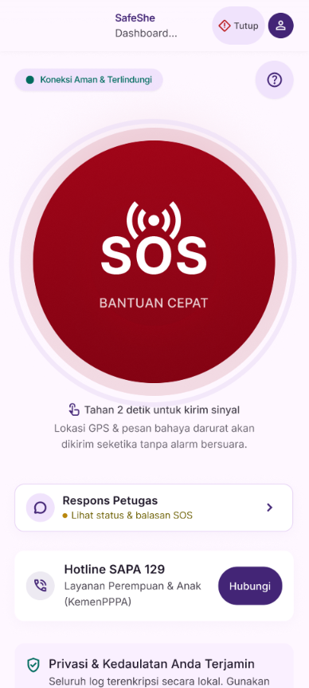  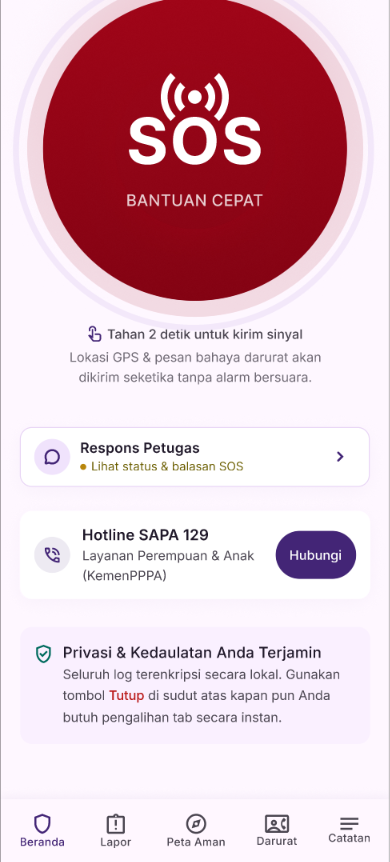 |
| *[I-02]* | 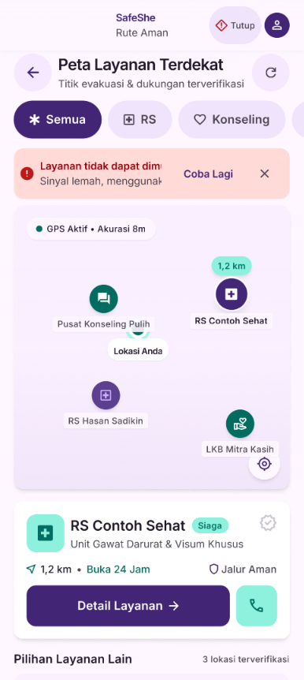  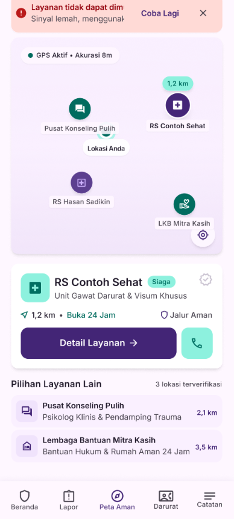 |
| *[I-03]* | 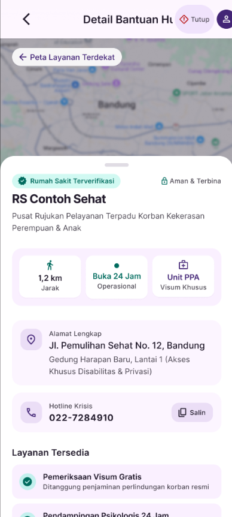  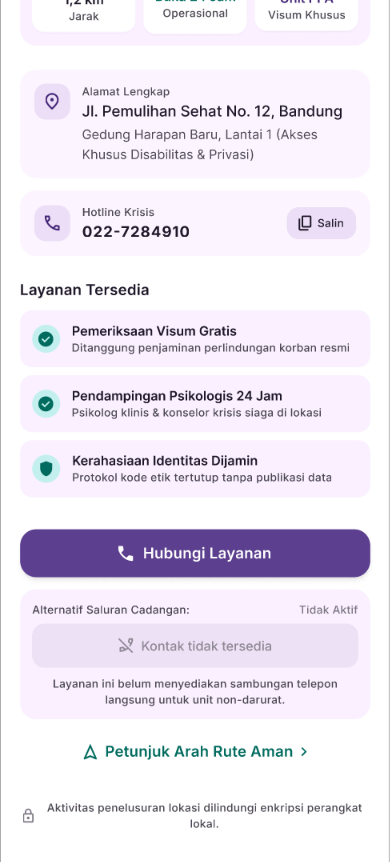 |
| *[I-04]* | 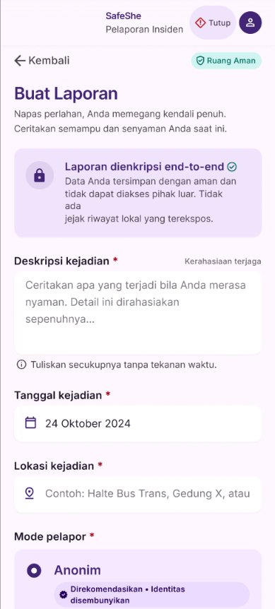  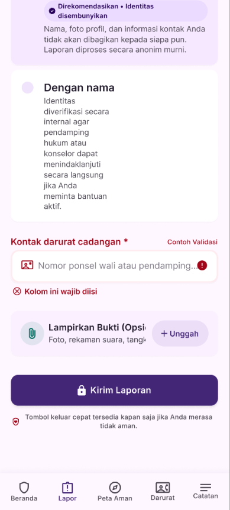 |
| *[I-05]* | 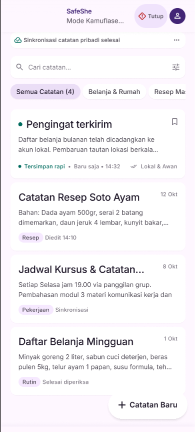  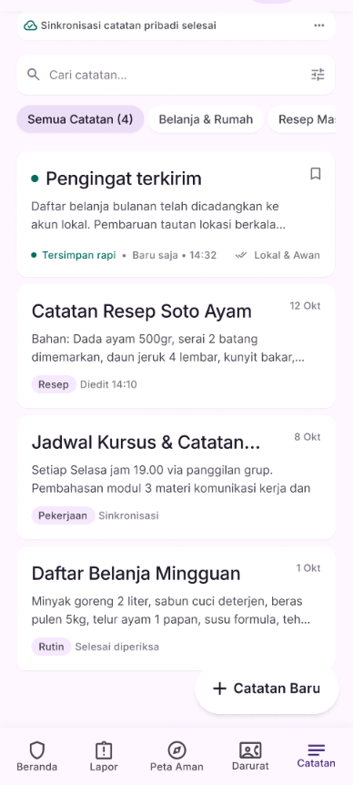 |
| *[I-06]* | 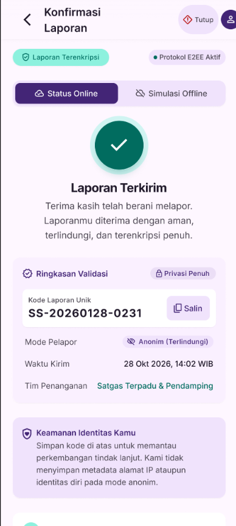  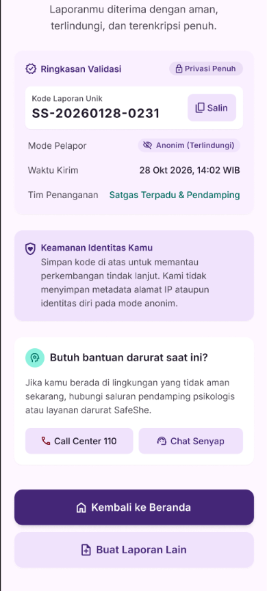 |
| *[I-07]* | 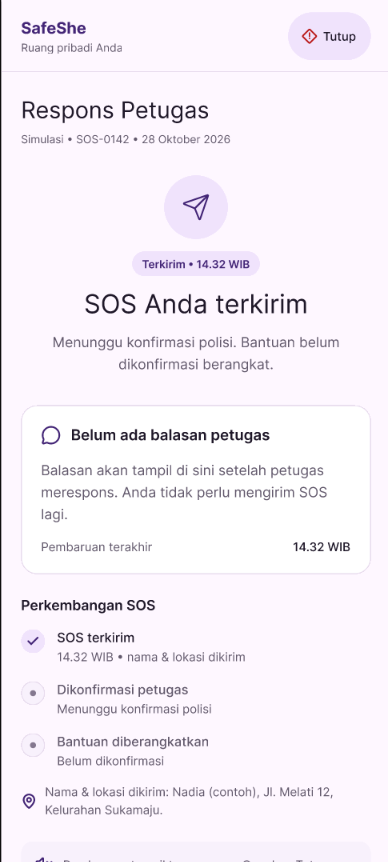  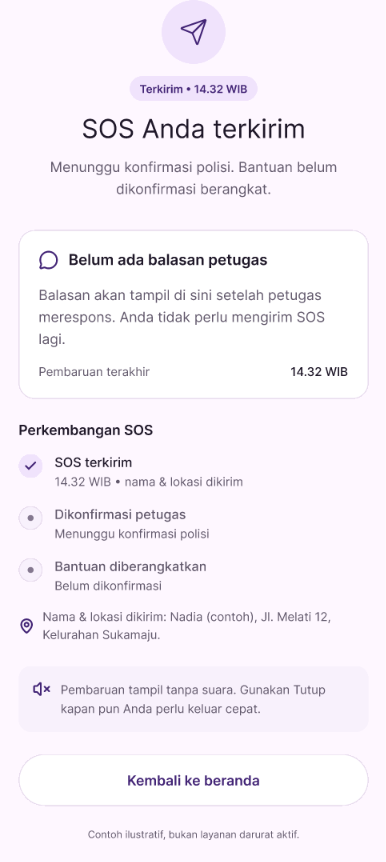 |
| *[I-08]* | 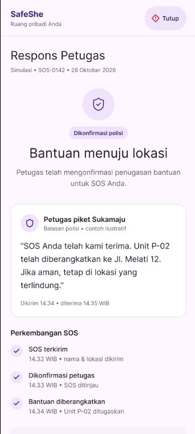  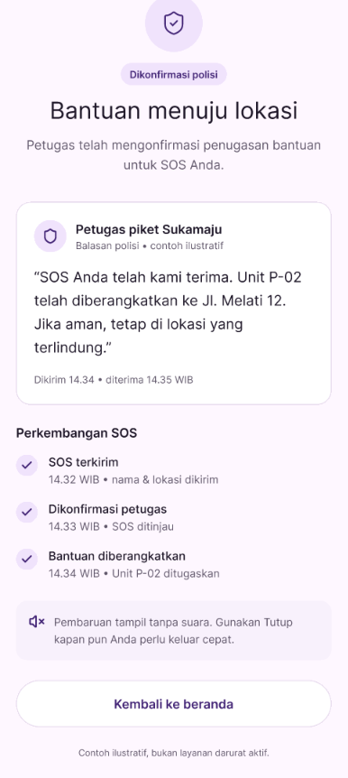 |
| *[I-09]* | 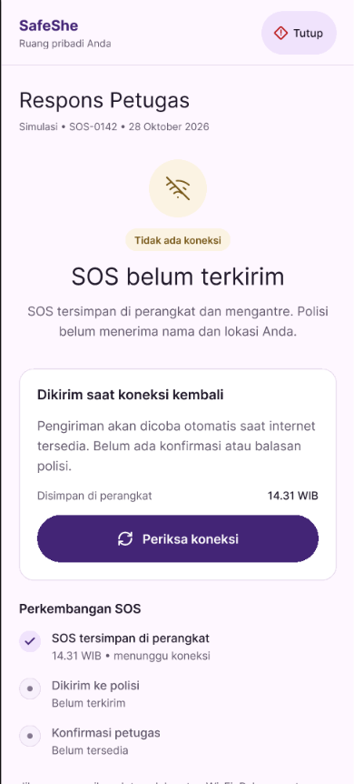  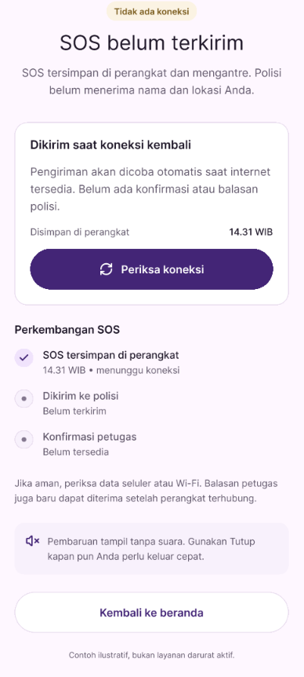 |
| *[I-10]* | 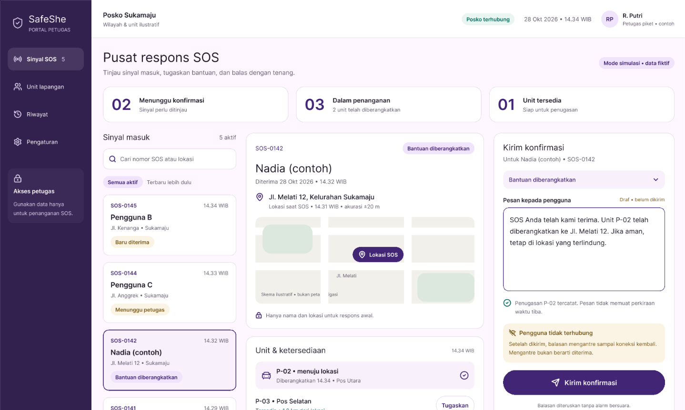  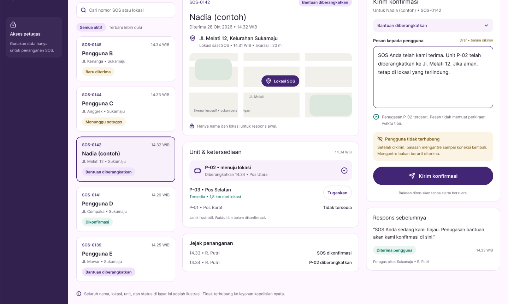 |
| *[I-11]* |    |


<br>

---

# BAB 7: Matriks Kerunutan

Petakan kelas perancangan dengan use case yang terkait. Gunakan **BAB 6 Traceability pada dokumen SKPL** sebagai acuan keterkaitan kelas analisis dan use case, lalu sesuaikan dengan realisasi use case dan kelas perancangan pada BAB 3–BAB 5 DPPL.

Tabel 7.1. Matriks Kerunutan Kelas terhadap Use Case

| Kelas | Use Case Terkait |
| :--- | :--- |
| *C01 - OneClickSOS* | *UC01 - Mengaktifkan one click SOS, UC06 - Merekam Suara Otomatis Ketika One Click SOS Diaktifkan, UC07 - Mengirim Notifikasi Konfirmasi Polisi Ke Korban* | 
| *C02 - AntarmukaPolisi* | *UC01 - Mengaktifkan one click SOS, UC06 - Merekam Suara Otomatis Ketika One Click SOS Diaktifkan, UC07 - Mengirim Notifikasi Konfirmasi Polisi Ke Korban* | 
| *C03 - Korban* | *UC01 - Mengaktifkan one click SOS, UC04 - Menghubungi Layanan Terdekat, UC05 - Membuat Laporan Kekerasan, UC07 - Mengirim Notifikasi Konfirmasi Polisi Ke Korban* | 
| *C04 - Peta* | *UC02 - Melihat Peta Layanan Terdekat, UC03 - Memilih Layanan Terdekat, UC04 - Menghubungi Layanan Terdekat* | 
| *C05 - ListLayanan* | *UC02 - Melihat Peta Layanan Terdekat, UC03 - Memilih Layanan Terdekat, UC04 - Menghubungi Layanan Terdekat* | 
| *C06 - Layanan* | *UC02 - Melihat Peta Layanan Terdekat, UC03 - Memilih Layanan Terdekat, UC04 - Menghubungi Layanan Terdekat* | 
| *C07 - AntarmukaTelepon* | *UC04 - Menghubungi Layanan Terdekat* | 
| *C08 - Polisi* | *UC01 - Mengaktifkan one click SOS, UC05 - Membuat Laporan Kekerasan, UC07 - Mengirim Notifikasi Konfirmasi Polisi Ke Korban* | 
| *C09 - Rekaman* | *UC06 - Merekam Suara Otomatis Ketika One Click SOS Diaktifkan* |
| *C10 - LaporanKekerasan* | *UC06 - Merekam Suara Otomatis Ketika One Click SOS Diaktifkan* | 
| *C11 - APILayanan* | *UC05 - Membuat Laporan Kekerasan* |
| *C12 - AntarmukaPetaLayanan* | *UC02 - Melihat Peta Layanan Terdekat* |
