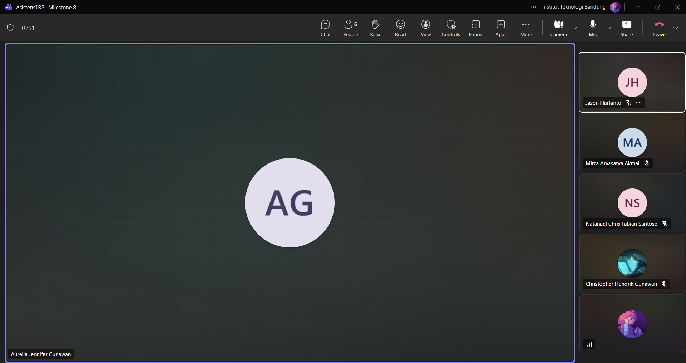

# Form Asistensi

## Tugas Besar IF2150 - Rekayasa Perangkat Lunak

| Informasi | Keterangan |
| --- | --- |
| **Hari** | *Sabtu* |
| **Tanggal** | *16/09/2026* |
| **Kelas** | *02* |
| **Nomor Kelompok** | *10*  |
| **Nama Kelompok** | *RPL at 25*  |
| **Nama Perangkat Lunak** | *SafeShe*  |
| **Dokumen** | *K02_G10_SKPL*  |

### Anggota Kelompok

| NIM | Nama |
| --- | --- |
| *13525083* | *Natanael Chris Fabian Santoso* |
| *13525131* | *Mirza Aryasatya Akmal* |
| *13525149* | *Ferdinand Valentino Darmawan* |
| *13525050* | *Jason Hartanto* |
| *13525065* | *Christopher Hendrik Gunawan* |

### Catatan

| Catatan |
| --- |
| 1. Bab 1, 2, 3, 4, 5 awal, dan 7 bisa dicopy dari milestone sebelumnya.|
| 2. Di bawah bab 7 tampilin bagian lampiran untuk masukin link figma yang dipake buat pembuatan antarmuka. Bagian lampiran ini boleh dibuat jadi bab 8 atau cukup jadi bagian lampiran aja. |
| 3. Di 5.1.1, itu untuk operasi yang perlu mengakses database, seperti getter dan setter. Contohnya untuk operasi getUser, parameternya ada userID, berarti querynya itu select dari tabel user di mana sesuai dengan userID nya. Sebenernya untuk getter setter itu opsional, jadi kalau mau dibikin boleh, kalau ga juga boleh, jadi untuk tabel query itu bisa untuk operasi dengan logika kompleks yang perlu cek database seperti operasi checkout, karena perlu lihat apa saja yang di keranjang dan mengurangi barang yang dipilih dari stoknya, atau database. Jadi baru ditulis, misalnya query untuk mengambil list barang di keranjang, lalu query untuk mengurangi stok barang, lalu query untuk mengosongkan keranjang. Intinya jika suatu operasi memiliki beberapa langkah yang melibatkan mengambil data dari database untuk melakukan operasi lain terhadap data atau melihat data untuk dimodifikasi di database, itu masukin ke tabel query karena ada multiple langkah. Lalu yang dimaksudnya dengan yang cukup penting itu logika yang punya algoritma bisnis atau percabangan, seperti validasi, intinya operasi yang core dari aplikasi, jadi tanpa operasi itu aplikasi tidak bisa. Contoh yang tidak penting itu cuma operasi buat nampilin ke layar, itu cukup masukin ke tabel yang operasi untuk kelas tersebut. Untuk pseudocode itu ga ada standarnya, palingan kalau perlu notasi bisa ikutin yang diajarin di Alpro 1 atau Alpro 2, soalnya pseudocode juga mostly sama aja. |
| 4. Di 5.1, untuk tipenya itu yang final nanti akan dipake buat pengimplementasiannya. |
| 5. Untuk tabel 6, itu antarmuka dipisah per halaman atau jika ada pop up yang muncul juga. Untuk pop up, cukup antarmuka khusus dari pop up tersebut saja. Lalu yang di tabel itu ga harus berurutan juga karena dari satu halaman bisa muncul banyak juga. Untuk penamaan ID objek itu dibebaskan penamaannya, jadi bisa kaya pake O-X atau yang lain juga. |
| 6. Untuk bagian 1.4, ada 4 yang perlu ditambahkan, algo, query, objek, dan antarmuka. |

**Notes for this section:**  
*Catatan dapat dituliskan dalam bentuk paragraf atau poin-poin, disesuaikan saja.* 

## Dokumentasi

<!--  -->

  

  <i>Gambar 1. Dokumentasi kegiatan asistensi.</i>

