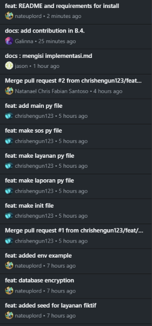

<h1>
IF2150 REKAYASA PERANGKAT LUNAK
 
TUGAS 9
 
IMPLEMENTASI PERANGKAT LUNAK
</h1>
 

## *SafeShe*

### Untuk: *Aurelia Jennifer Gunawan*

Dipersiapkan oleh:
| Informasi | Keterangan |
| --- | --- |
| Kelas | *K2* |
| Kelompok | *10* |

| NIM | Nama |
|---|---|
| *13525083* | *Natanael Chris Fabian Santoso* |
| *13525131* | *Mirza Aryasatya Akmal* |
| *13525149* | *Ferdinand Valentino Darmawan* |
| *13525050* | *Jason Hartanto* |
| *13525065* | *Christopher Hendrik Gunawan* |
---

# BAGIAN B: Laporan Implementasi

## B.1 Perubahan dari DPPL

Tabel B.1. Perubahan dari DPPL

| No | Bagian DPPL | Rancangan Awal | Implementasi Akhir | Alasan |
| :--- | :--- | :--- | :--- | :--- |
| *1* | *Tabel 2.1 Client* | *React Native + SQLite lokal + react-native-fs* | *Aplikasi web (HTML/JavaScript) dengan antrean offline di `localStorage`* | *Harus dapat dijalankan asisten tanpa emulator atau build mobile; pola offline-first tetap dipertahankan* |
| *2* | *Tabel 2.1 DBMS* | *PostgreSQL* | *SQLite* | *Syarat tugas: dapat dijalankan lokal tanpa akun atau Docker* |
| *3* | *Bab 2.2 Server* | *Layered modular dengan beberapa lapisan microservice dan API Gateway* | *Satu aplikasi FastAPI modular (`backend/main.py` + `backend/domain/`)* | *Skala tugas tidak membutuhkan pemisahan layanan; lapisan rute, domain, dan data tetap terpisah* |
| *4* | *Tabel 2.3 Komponen* | *`SOSController`, `PetaLayananController`, `LaporanController`, `ValidasiLaporan`, `AntarmukaSOS`, `AntarmukaLaporan`, `PenyimpananLokal`, `SafeSheAPI`, `SistemPolisi`* | *Controller menjadi route handler di `main.py`; `ValidasiLaporan` menjadi `LaporanKekerasan.cekKelengkapan()`; antarmuka menjadi bagian `index.html`/`app.js`; `PenyimpananLokal` menjadi antrean `localStorage`; `SistemPolisi` disimulasikan oleh dashboard `police.html`* | *Komponen tersebut tidak termasuk kelas perancangan Tabel 4.1; fungsinya diwujudkan tanpa kelas tersendiri* |
| *5* | *Bab 1.2 Enkripsi* | *Laporan terenkripsi end-to-end* | *Enkripsi sisi server (Fernet) pada data tersimpan; kunci di `data/.key` atau `SAFESHE_DATA_KEY`* | *E2E sungguhan membutuhkan manajemen kunci polisi yang di luar cakupan tugas* |
| *6* | *UC07 Konfirmasi* | *Konfirmasi balik "tidak mudah diketahui orang lain"* | *Status polisi ditampilkan sebagai pesan pesanan netral ("Pesanan Anda sedang dalam pengiriman.")* | *Mewujudkan kerahasiaan konfirmasi* |
| *7* | *UC06 Rekaman* | *Merekam audio setelah SOS* | *Rekaman dipotong per segmen 15 detik, maksimal 5 menit, dan diunggah per segmen* | *Setiap segmen dapat diputar sendiri dan tidak hilang jika koneksi terputus di tengah* |
| *8* | *Operasi `tungguKoneksi`, `teleponLayanan`, `masukkanNomorLayanan`* | *Operasi pada kelas* | *Fungsi JavaScript (`flush`, tautan `tel:`)* | *Dikerjakan di klien web; nomor dikirim ke aplikasi telepon bawaan perangkat* |
| *9* | *Antarmuka klien (semua layar)* | *Belum dirinci per layar* | *UI mengikuti desain Figma "SafeShe UI": Beranda, Layanan Terdekat, Detail Layanan, Buat Laporan, Konfirmasi Laporan, Respons Petugas, Status samar (tampilan catatan), Panduan, dan dashboard polisi* | *Desain final dari tim; hanya mode terang yang diimplementasi* |
| *10* | *UC01 One-Click SOS* | *Satu ketukan* | *Tombol ditahan 1,5 detik (cincin progres terisi); ketukan singkat tidak mengirim* | *Mengikuti desain Figma; mencegah SOS tidak sengaja. Tombol tetap siap dipakai lagi setelah terkirim, dan pengiriman ganda dalam 10 detik ditolak* |
| *11* | *Lembar status SOS* | *Tombol "Batalkan" pada desain* | *Tombol "Tutup"* | *Permintaan sudah dikirim ke server dan tidak dapat ditarik, sehingga "Batalkan" menyesatkan* |
| *12* | *Teks privasi pada desain* | *"Tidak ada jejak riwayat lokal" dan "anonim murni"* | *"Tidak ada salinan yang tersisa di perangkat setelah terkirim" dan "nama dan kontak tidak disimpan"* | *Teks asli tidak benar: antrean offline memang tersimpan di perangkat sampai terkirim, dan server tetap melihat alamat IP* |
| *13* | *Bukti tambahan pada form laporan* | *Kotak lampiran bukti* | *Tidak diimplementasikan* | *Di luar use case SKPL dan tidak ada tabel penyimpanannya* |
| *14* | *Label navigasi bawah* | *Lima tab tanpa label tertulis pada ekspor* | *Beranda, Lapor, Layanan, Panduan, Status* | *Label disimpulkan dari urutan dan isi layar* |
| *15* | *Dashboard polisi (C02)* | *Antarmuka sederhana* | *Dashboard tiga kolom: antrean, detail kasus + unit terdekat + rekaman, penyusun balasan* | *Mengikuti desain Figma; unit terdekat dihitung server dari tabel `polisi`* |
| *16* | *Tabel `layanan`* | *nama, jenis, lokasi, kontak* | *Ditambah `alamat` dan `fasilitas`* | *Dibutuhkan layar Detail Layanan* |
| *17* | *Tab Status (tampilan catatan)* | *Tampilan statis* | *Catatan berfungsi: tambah, ubah, hapus, filter kategori (Belanja, Jadwal, Resep), dan pencarian. Catatan status SOS selalu tampil di bagian atas* | *Agar tampilan penyamaran meyakinkan jika dibuka orang lain. Pada tab ini header SafeShe dan menu bawah disembunyikan, judul tab peramban menjadi "Catatan", dan jalan keluarnya hanya ketuk dua kali tombol + (dijelaskan di Panduan). Penyamaran penuh melampaui desain Figma, yang masih menampilkan header dan menu* |
| *18* | *Tabel `laporan` dan dashboard polisi* | *Laporan hanya dibaca* | *Ditambah kolom `status` (baru, ditinjau, ditindaklanjuti, selesai) dan `catatan`; endpoint `POST /api/polisi/laporan/{token}/tindak`* | *Agar petugas dapat membuka laporan dan mencatat tindak lanjut* |
| *19* | *Basis data* | *Dibuat dari nol* | *Migrasi otomatis saat server mulai (`ALTER TABLE` bila kolom belum ada)* | *Database dari versi sebelumnya tetap dapat dipakai tanpa dihapus* |
| *20* | *UC05 Laporan (umpan balik ke pelapor)* | *Pelapor hanya menerima konfirmasi* | *Pelapor dapat memeriksa status lewat kode laporan (layar Status laporan) dan membaca pesan singkat dari petugas; endpoint `GET /api/laporan/{token}/status`; kolom `pesan_pelapor` dan `updated_at`* | *Mode anonim tidak punya akun, sehingga kode laporan menjadi satu-satunya jalur umpan balik. Endpoint hanya mengembalikan status dan pesan, tidak pernah isi laporan, nama, atau catatan internal* |
| *21* | *Header dan Beranda* | *Tombol info (kanan atas header) dan tombol perisai (kanan atas Beranda)* | *Kedua tombol dihapus; Panduan tetap dapat dibuka dari menu bawah* | *Tombol perisai tidak memberi fungsi yang jelas (diganti Panduan), dan keduanya menambah kekacauan visual* |
| *22* | *UC06 Rekaman suara* | *Rekaman berjalan sampai selesai* | *Tombol "Hentikan rekaman suara" di Beranda dan di lembar status SOS; mikrofon dilepas dan segmen terakhir tetap diunggah* | *Korban perlu kendali untuk mematikan mikrofon setelah SOS* |
| *23* | *Tab Status (halaman samar)* | *Jalan keluar hanya ketuk dua kali tombol + tanpa penjelasan* | *Petunjuk sekali tampil dengan tombol + berkedip; jalan keluar kedua lewat ketuk dua kali judul "Catatan"; target tombol 48 px; petunjuk dapat dilihat lagi dari Panduan* | *Fitur tersembunyi harus dapat ditemukan pengguna. Petunjuk hanya muncul sampai dikonfirmasi satu kali (flag di `localStorage`), setelah itu tampilan samar bersih* |
| *24* | *Dashboard polisi, balasan SOS* | *Panel detail digambar ulang tiap data berubah* | *Peta, daftar rekaman, dan kotak balasan diperbarui terpisah; draf balasan disimpan per SOS dan rekaman baru ditambahkan tanpa menghentikan pemutar* | *Ketikan petugas sebelumnya terhapus saat ada rekaman baru dari korban* |

## B.2 Bukti Penerapan Best Practices

Tabel B.2. Bukti Best Practices

| Praktik | Bukti | Keterangan |
| :--- | :--- | :--- |
| *Branching* | *[ISI: tautan daftar branch / graph commit]* | *[ISI: skema yang dipakai, mis. `feat/<fitur>`]* |
| *Semantic commit* | ** | *Contoh dari semantic commit, dengan format `<type>/<description>`* |
| *Track tasks* | *[ISI: tautan Issues/Projects]* | *[ISI: jumlah issue dan pembagian]* |
| *Pull request dan review* | *[ISI: tautan 2-3 PR]* | *[ISI: siapa me-review siapa]* |
| *Pengujian* | *`src/tests/test_api.py`; jalankan `python -m pytest tests -v` dari `src/`* | *16 tes lolos: haversine, urutan dan radius layanan, filter jenis, kontak kosong, alur SOS lengkap (idempoten, autentikasi polisi, rekaman, balasan disamarkan), SOS tanpa lokasi, laporan tidak lengkap, validasi tanggal/identitas, enkripsi dan mode anonim, teks balasan dan waktu pada status SOS, unit terdekat untuk polisi, alamat dan fasilitas layanan, tindak lanjut laporan, pelapor cek status lewat kode tanpa kebocoran data, migrasi database lama* |

### B.2.1 Profiling dan Optimasi

| Informasi | Keterangan |
| :--- | :--- |
| *Fitur / proses yang diprofil* | *Pencarian layanan terdekat (UC02), `GET /api/layanan/nearby`* |
| *Alat* | *`cProfile`, `EXPLAIN QUERY PLAN` SQLite, pengukuran waktu (`src/tests/profile_nearby.py`, 50.000 layanan fiktif, rerata 30 permintaan, radius 10 km)* |
| *Temuan (sebelum)* | *Rata-rata 89,06 ms/permintaan. `EXPLAIN`: `SCAN layanan`. Profil: seluruh baris dibaca (`fetchall`) lalu `haversine_km` dipanggil 50.000 kali per permintaan (0,66 dari 1,10 detik pada 5 permintaan)* |
| *Perbaikan* | *Menambah indeks `idx_layanan_lat_lon(lat, lon)` dan menyaring dengan bounding box di SQL sebelum menghitung jarak haversine* |
| *Hasil (sesudah)* | *3,17 ms/permintaan (sekitar 28 kali lebih cepat). `EXPLAIN`: `SEARCH layanan USING INDEX idx_layanan_lat_lon`* |

Angka diukur pada mesin pengembangan penulis; hasil pada mesin lain akan berbeda tetapi rasionya serupa.

## B.3 Kendala dan Catatan Penting

- **Menjalankan:** ikuti `src/README.md`. Dashboard polisi memakai API key demo `polisi-demo`. Basis data dan data fiktif dibuat otomatis saat server pertama berjalan.
- Geolokasi dan mikrofon hanya aktif di `localhost` atau HTTPS. Font Inter, Leaflet, dan tile peta dimuat dari internet; tanpa itu tampilan memakai font sistem dan daftar layanan tetap berfungsi.
- **Known issues:**
  - Antrean offline di `localStorage` tidak terenkripsi; item dihapus setelah berhasil terkirim.
  - Segmen rekaman yang belum terunggah disimpan di memori, sehingga hilang jika tab ditutup sebelum ada koneksi.
  - Konfirmasi polisi memakai *polling* tiap 5 detik, bukan *push notification*.
  - Autentikasi dashboard polisi hanya API key bersama; tidak ada akun per petugas.
  - Enkripsi bersifat sisi server, bukan E2E (lihat B.1 nomor 5).
  - `SistemPolisi` disimulasikan; tidak ada integrasi nyata ke sistem kepolisian.
  - Pengujian otomatis mencakup API dan logika domain. Klien juga diuji di DOM tiruan (jsdom) terhadap server asli: tahan-untuk-kirim, anti-ganda, perpindahan layar, layanan, detail, dan laporan. Tampilan visual, geolokasi, mikrofon, dan peta belum dicoba di peramban sungguhan dan perlu dicek manual.
  - Status laporan dapat dilihat siapa pun yang memegang kode laporan (64 bit acak). Pesan petugas harus ditulis netral, dan dashboard memberi peringatan itu. Kode tidak disimpan di perangkat; pelapor perlu menyimpannya sendiri.
  - Penyamaran hanya menutupi tampilan layar dan judul tab. Riwayat peramban, alamat `localhost`, dan data di penyimpanan peramban tetap dapat memperlihatkan aplikasi ini jika perangkat diperiksa.
  - Catatan buatan pengguna di tab Status disimpan di `localStorage` perangkat tanpa enkripsi. Isinya hanya penyamaran, jadi jangan menulis informasi sensitif di sana.
  - Balasan petugas tampil eksplisit di layar Respons Petugas (sesuai desain). Hanya tab Status yang disamarkan, jadi orang yang memegang ponsel dapat membacanya jika layar itu terbuka. Tombol Keluar membantu menutupnya.

## B.4 Kontribusi Anggota

Tabel B.4. Kontribusi Anggota

| NIM | Nama | Modul / Fitur yang Dikerjakan | Persentase Kontribusi |
| :--- | :--- | :--- | :--- |
| *13525083* | *Natanael Chris Fabian Santoso* | *[ISI]* | *[ISI]* |
| *13525131* | *Mirza Aryasatya Akmal* | *[ISI]* | *[ISI]* |
| *13525149* | *Ferdinand Valentino Darmawan* | *profiling waktu pengambilan layanan terdekat* | *20%* |
| *13525050* | *Jason Hartanto* | *api testing* | *20%* |
| *13525065* | *Christopher Hendrik Gunawan* | *[ISI]* | *[ISI]* |

Modul yang tersedia untuk dibagi: SOS dan balasan polisi (UC01, UC07); rekaman suara (UC06); peta dan layanan (UC02-UC04); laporan kekerasan (UC05); dashboard polisi, basis data, dan uji.

## B.5 Traceability Kelas Perancangan ke Implementasi

Tabel B.5. Traceability Kelas Perancangan ke Implementasi

| ID Kelas | Nama Kelas Perancangan | Bentuk Implementasi | Lokasi (File dan Nama) | Keterangan |
| :--- | :--- | :--- | :--- | :--- |
| *C01* | *OneClickSOS* | *Kelas + handler klien + route* | *`src/backend/domain/sos.py` - `OneClickSOS`; `src/frontend/app.js` - handler `#sosBtn`, `startRecording`, `flush`; `POST /api/sos`, `GET /api/sos/{id}/status` di `src/backend/main.py`* | *`dapatLokasi`, `kirimSinyal`, `menerimaReply` menjadi metode kelas; `panggilSOS` menjadi handler tombol; `signalMikrofon` menjadi `startRecording` (respons `rekam: true`); `tungguKoneksi` menjadi `flush` dan antrean offline* |
| *C02* | *AntarmukaPolisi* | *Route + halaman web* | *`src/backend/main.py` - `/api/polisi/*`; `src/frontend/police.html`* | *`menerimaSinyal` menjadi `GET /api/polisi/sos` dan tabel dashboard; `kirimReply` menjadi `POST /api/polisi/sos/{id}/reply`* |
| *C03* | *Korban* | *Kelas + fungsi klien* | *`src/backend/domain/sos.py` - `Korban`; `src/frontend/app.js` - `getPos`, `pilih`* | *Atribut `namaKorban`, `lokasiKorban` menjadi atribut kelas; `lokasiKorbanSekarang` menjadi `getPos` di klien; `pilihLayanan` menjadi `pilih`; `teleponLayanan` menjadi tautan `tel:`* |
| *C04* | *Peta* | *Kelas* | *`src/backend/domain/layanan.py` - `Peta`* | *`lokasiPeta` atribut; `lokasiPetaSekarang`, `lokasiSekitar` metode; `tampilkanLayanan` ditangani C12* |
| *C05* | *ListLayanan* | *Kelas* | *`src/backend/domain/layanan.py` - `ListLayanan`* | *`kumpulanLayanan` atribut; `ambilLayananTersedia(peta)` mengambil data via C11, menghitung jarak, mengurutkan, dan membatasi* |
| *C06* | *Layanan* | *Kelas + route* | *`src/backend/domain/layanan.py` - `Layanan`; `GET /api/layanan/{id}` di `main.py`* | *Atribut nama, lokasi, kontak; `ambilNama`, `ambilLokasi`, `ambilKontak`; `ambilDataLayanan` menjadi metode statis* |
| *C07* | *AntarmukaTelepon* | *Elemen antarmuka* | *`src/frontend/app.js` - `pilih()` (tautan `tel:`)* | *`masukkanNomorLayanan` diwujudkan dengan membuka aplikasi telepon bawaan perangkat lewat `tel:`* |
| *C08* | *Polisi* | *Kelas* | *`src/backend/domain/sos.py` - `Polisi`; tabel `polisi` di `db.py`* | *`pantauAntarmuka`, `kirimPasukan` menjadi metode statis; `lokasiPolisi`, `ketersediaan` menjadi kolom tabel; `terdekat` tambahan* |
| *C09* | *Rekaman* | *Kelas + fungsi klien + route* | *`src/backend/domain/sos.py` - `Rekaman`; `src/frontend/app.js` - `startRecording`, `uploadPending`; `POST /api/sos/{id}/recording`* | *`mulaiRekamanSuara` menjadi `startRecording` (MediaRecorder); `simpanRekamanSuara` menjadi `Rekaman.simpanRekamanSuara`; `rekamanSuara` menjadi berkas di `data/uploads` + tabel `rekaman`* |
| *C10* | *LaporanKekerasan* | *Kelas + form klien + route* | *`src/backend/domain/laporan.py` - `LaporanKekerasan`; form di `index.html`/`app.js`; `POST /api/laporan`* | *Atribut menjadi atribut kelas; `masukkan*` menjadi parameter konstruktor dan kolom form; `cekKelengkapan` menjadi validasi 422* |
| *C11* | *APILayanan* | *Kelas + route* | *`src/backend/domain/layanan.py` - `APILayanan`; `GET /api/layanan/nearby`* | *`urlAPI` atribut; `ambilDataLayanan(peta)` menjalankan kueri bounding box berindeks* |
| *C12* | *AntarmukaPetaLayanan* | *Fungsi/komponen klien* | *`src/frontend/app.js` - `loadLayanan`, `renderLayanan`; `index.html` - `#tab-peta`* | *`tampilkanPeta` memakai Leaflet; `renderSimbolLayanan` menjadi penanda peta dan daftar layanan* |